[English](README.md) | [简体中文](README.zh-CN.md)

# Agent Workspace for Android

An AI agent that runs on your Android phone. It plans and carries out multi-step tasks with real tools — files, PDFs, web search, an optional Linux toolchain and Android system actions — and, with the accessibility service turned on, operates other apps on the phone when you ask it to. It uses a cloud model you choose, Ollama on a computer in your local network, or a model that runs entirely on the phone. Everything is packaged in one APK; no Termux or root is needed.

<p align="center">
  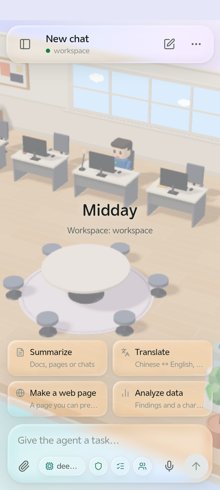
  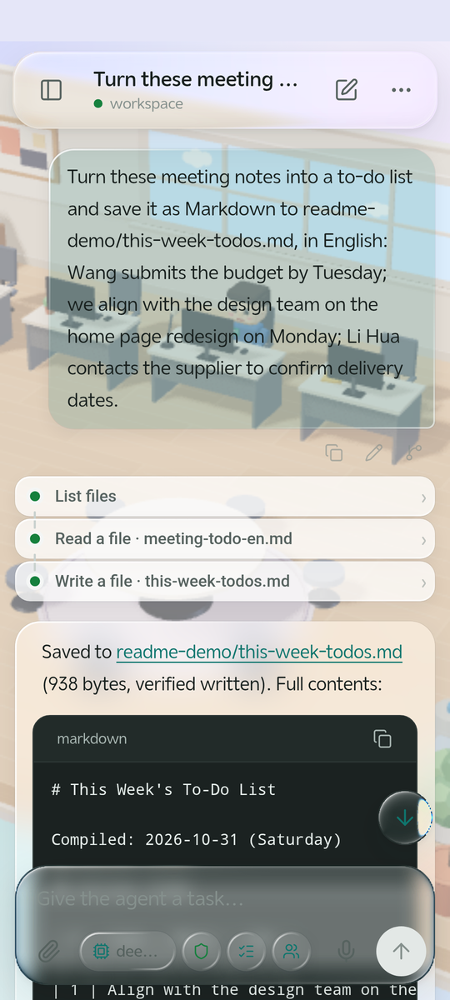
  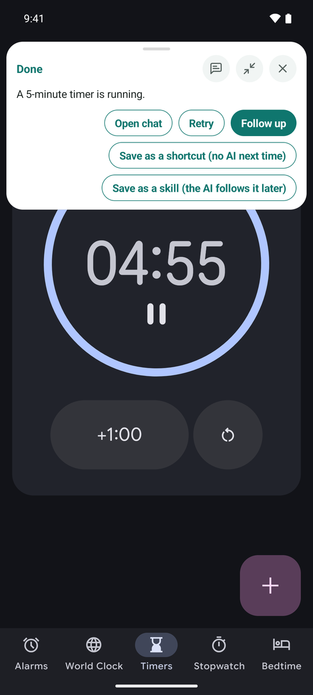
</p>

## Download

Get `AgentWorkspace_2.4.0_android.apk` from [Releases](https://github.com/WhitePepperLambSoup/agent-workspace-android/releases) and install it. The release notes list its SHA-256. Later versions can be installed from inside the app: it checks at every start and about every 12 hours, and you can check yourself under Menu → About and updates, or "Updates" on the loading screen. Changes in each version are listed in the [CHANGELOG](CHANGELOG.md).

- Android 8.0 (API 26) or newer, 64-bit ARM (`arm64-v8a`) or `x86_64`; phones running a 32-bit-only system cannot install it.
- The interface is shown by the system's Android System WebView, which must be Chromium 80 or newer. If WebView is disabled, missing or too old, the app explains why and links to the app store to update it.
- Works on Android 15+ devices with 16 KB memory pages, foldables, split screen and external keyboards, and keeps its own colours under system or vendor "force dark" modes.
- About 73 MB to install. Local models and the offline speech model are optional downloads inside the app.

What changed in 2.4.0: file history, search by meaning in the knowledge base, privacy routing, Japanese and Korean, elder mode's Help button, backup passphrases and more triggers are new; fixes from a full review of the app, including several in approvals and outside content.

## Features

### Conversations and multi-step tasks

<p align="center">
  
  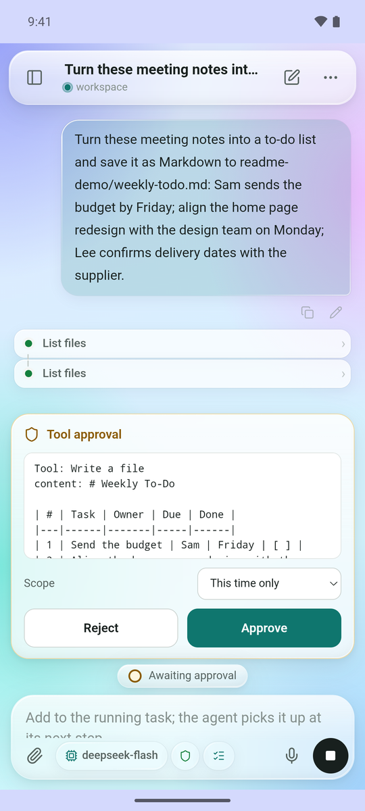
  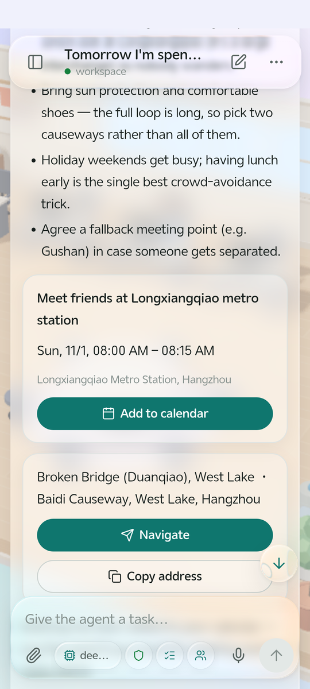
</p>

- **Multi-step tasks.** The agent plans, calls tools and shows every step live: the streamed reply, its reasoning, and each tool call as running, finished, failed or cancelled. Generated files appear under the reply, ready to open, share or save.
- **Add to a running task.** Type while a task runs and your message joins it; the agent takes it into account at its next step instead of starting over.
- **Approvals.** Three execution modes — workspace only, YOLO, full access — and an approval prompt before sensitive actions, for this time only or for the rest of the task; deleting files, changing long-term memory, operating other apps from a chat and replying to notifications still ask every time.
- **Cards in replies.** Checklists you can tick, comparison tables, events that go into the calendar and places that open in the map with one tap, and next steps that send their request when tapped.
- **Models and reasoning effort.** The model button in the message box switches between your usual model profiles and sets the reasoning effort with a slider, without restarting the engine between cloud models. Messages can be edited and resent, replies regenerated, and conversations archived or deleted for good.
- **Math and diagrams.** LaTeX formulas and Mermaid diagrams in replies are rendered.
- **Plan mode and skills.** In plan mode the agent only looks and proposes a plan, acting once you agree; the Skills page installs official skills or imports SKILL.md files, which the agent reads only when needed. A skill can be shared as a signed share code; importing one shows who signed it and what its instructions mention (messages, payments, deleting, personal data) before it is installed.
- **Sub-tasks.** When a task has independent parts (several documents to read, options to compare), the agent can hand them to sub-tasks that run side by side (up to 4 per call, 3 at a time) and combine their reports. Sub-tasks can only look at files, the knowledge base, memory and web pages; they cannot change files, run commands or operate the phone. Each has its own conversation, which you can open from the archive.
- **Per-task limit.** Model & reasoning sets a cost and a token limit for each task, counting the sub-tasks it starts; a task that reaches one stops and says which. Tokens & cost shows conversations, summaries and sub-tasks separately. Before you send, the line under the input box estimates what the message is likely to cost, from recent tasks.
- **Fork a conversation.** Start a new conversation from any message. From your message, it keeps what came before and puts the message back in the input box to rewrite; from a reply, it keeps everything up to that reply. The original stays as it is, the AI in the new one remembers what came before, and both share the workspace's files.
- **Compare with another model.** Ask another model of the current provider the same question and see both answers together, each with its model time (not counting the wait for your approval) and tokens; continue with the other answer if you prefer it.

### Phone control

This needs the app's accessibility service, which you turn on in system settings. In any app, tap Operate phone on the floating bubble and write what you want in the small window that opens: the agent looks at the screen, taps, swipes, types and opens apps by name, and shows each step in the window.

<p align="center">
  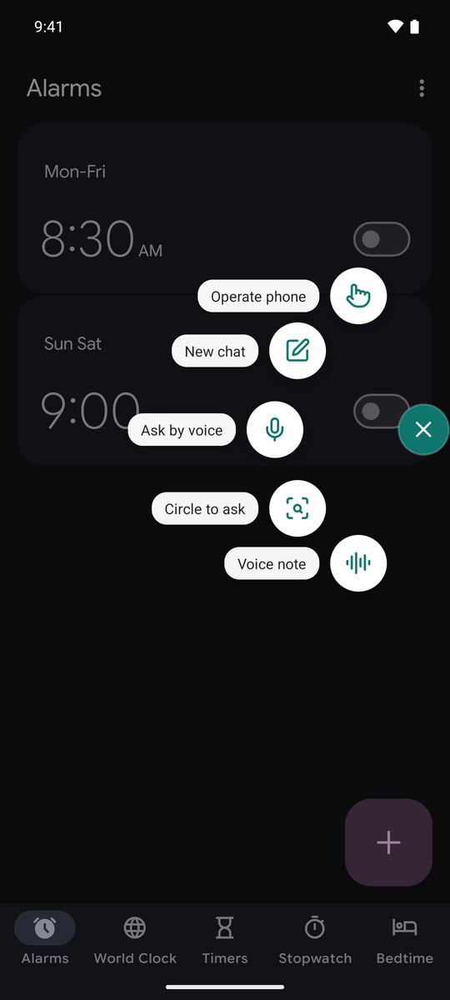
  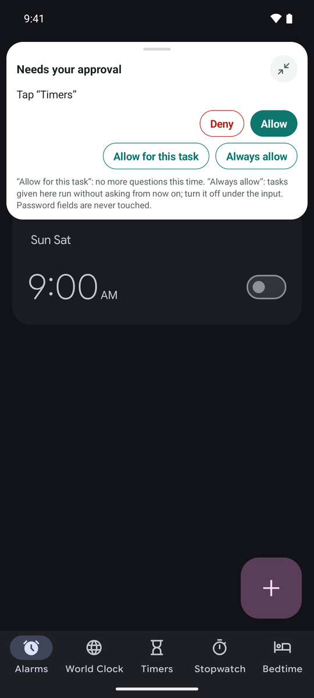
  
</p>

- **Approvals in the window.** Steps that need your approval are asked in the window: Allow, Allow for this task, or Always allow (hosted mode). Hosted work has step and time limits. You can refresh, pause, stop or retry at any time.
- **Safety rules.** Pay, transfer and order buttons and payment password screens are never touched, in any mode (the rule is built into the app); delete and clear buttons stop for your approval; password fields and the lock screen are off limits. When a web page, a notification or the screen holds what looks like instructions to the agent, the task's hosted approval and the conversation's earlier approvals end, every further step asks you, and nothing is saved to memory, app notes or skills for the rest of that task.
- **Look back.** Every step keeps a small screenshot that you can step through after the task. The pictures stay on the phone for the latest 20 tasks and at most 7 days; screens with passwords or other sensitive content are not captured.
- **Picture guides.** Turn a phone task into one long picture: each step says what was done, the spot it touched is circled in red on the screen it was done on, and floating windows such as the bubble are painted out. Change the words, drop steps, and share it, for example to show a relative how to do it.
- **Shortcuts.** A finished task can be saved as a shortcut that repeats the steps without the model; steps can be edited, and shortcuts can run on a schedule or on a trigger. When an app update gets a shortcut stuck at a step, the agent finishes from that step and one tap puts its steps into the shortcut. Shortcuts can be shared as signed codes; an import shows who signed it and lists every step before it is saved.
- **Circle to act.** Circle part of the screen and the phone reads the words offline, then offers what fits: call, open a link, navigate, add to the calendar, compare prices, translate, save to a knowledge base or copy the text; or send the circled part to the agent with a question. Nothing is captured while a password field is on screen.
- **App notes.** While the agent works, the phone notes which buttons in each app lead somewhere and which do nothing, and the agent can add a few lines on how an app works; later tasks see these when they enter that app. View, delete or turn them off at the bottom of the Memory page. Typed text and anything with long numbers in it is never recorded.
- **Phone state.** After each step the agent knows whether the screen changed and whether the keyboard or the notification shade covers the app; a dark screen is turned on before an action, and on a locked phone the agent stops and asks you to unlock it. Tapping a greyed-out button tells it the button is disabled.
- **Background mode (experimental).** Turned on under Device & tools, phone tasks from a conversation run on a hidden background screen while you keep using the phone; bring the app to the front to look at it. This needs Shizuku (no root); the page walks through installing and starting it, and after the phone restarts a notification points back there. Approvals, the apps the AI may not operate and the no-payments rule apply in the background too.

<p align="center">
  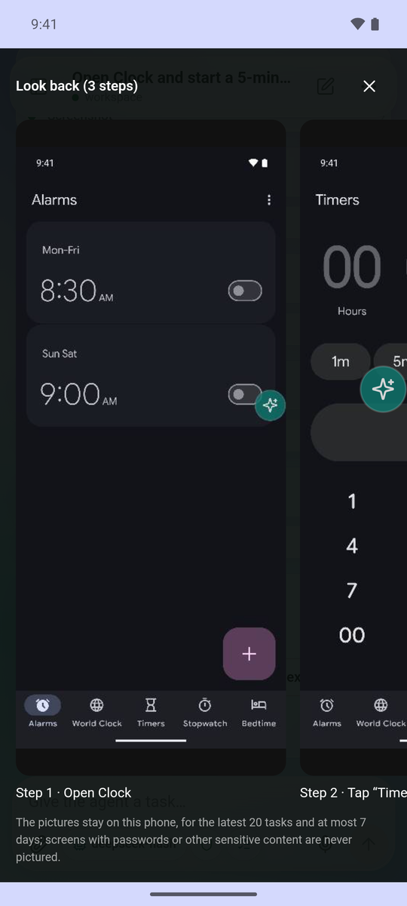
  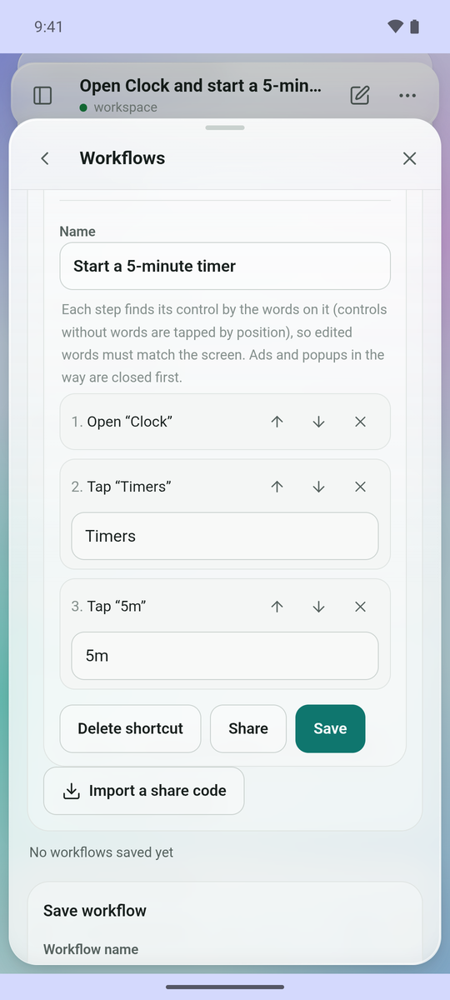
  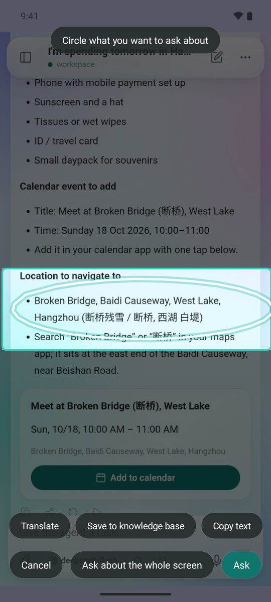
</p>

### Elder mode

Set up by a family member under Menu → Elder mode, for an older person in the family.

- **One Speak button.** The whole screen becomes one big Speak button: tap it, say what you want to ask, and the AI answers in a few plain sentences and reads them aloud, with Hear it again under the answer. Only the latest question and answer stay on the screen; reminders and questions about the phone are simply said. Two more buttons, Ask about a photo and Call family, and typing for when speaking is hard; leaving takes a two-second press, and an exit PIN can be set.
- **Nothing to approve.** The AI answers, looks things up and also operates the phone directly. Typing or sending a bank card or ID number, sending a code in a message, opening remote-control apps, deleting files, removing apps, and any action after content that looks like someone instructing the AI are refused automatically, and the AI says why in plain words; while the mode is on, it does not operate Android's app installer or remote-control apps either.
- **Help button.** Once a family number is set, Help writes a text to the family member, with the phone's location when allowed, for the older person to send.
- **Smooth on modest phones.** The app underneath is not drawn while the mode is on, its screen appears first at start, it offers everyday tools only, and a fresh conversation each day keeps requests and history small.

### Notification digest, briefing and automation

<p align="center">
  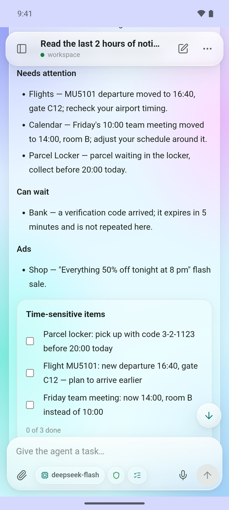
</p>

- **Notification digest.** With Keep notifications for digests on, incoming notifications are kept on the phone only, for 48 hours; on request they are sorted into needs attention, can wait and ads, with pickup codes, flights and trains, meeting changes and bills due listed separately in a checklist. Verification codes are never repeated. The digest can run every 2 hours.
- **Morning briefing.** Calendar, weather, voice note points and to-dos; an AI card on the home screen shows a scheduled task's latest result.
- **Schedules and triggers.** Scheduled tasks also run in the default workspace mode; tasks can start when the phone starts charging, joins Wi‑Fi, an app opens, the battery drops below a level, headphones or a Bluetooth audio device connect, the phone is unlocked or a calendar event is some minutes away, or when an app such as Tasker sends a request.
- **Notification rules.** When a notification from an app you chose arrives, the agent handles it the way you describe, such as noting a parcel pickup code; by default it asks you first.
- **Reply to notifications.** The agent can list the notifications in the shade and answer a message with the app's own quick reply (Messages, WeChat, QQ, Telegram and other apps that offer one) without opening the app; you approve each reply on its own before it is sent. It can also open the page a notification leads to. This needs notification access.
- **Reusable workflows** with step replay, task evaluations and hand-off between devices.

### Models

<p align="center">
  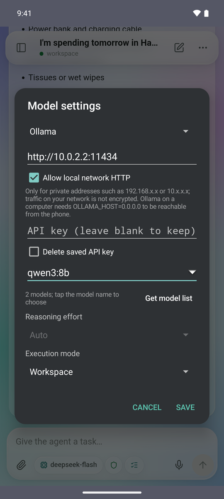
</p>

- **Cloud providers.** OpenAI-compatible APIs (OpenAI, DeepSeek, Qwen, Kimi, GLM, xAI …), Anthropic, Gemini and Ollama. With DeepSeek, OpenAI, Kimi, Qwen, GLM, Gemini, Grok, OpenRouter or Claude, every request only grows at the end, so the provider's context cache covers most of the input (about 95% in long DeepSeek tasks on a phone), billed at a lower price.
- **Ollama on your network.** With Allow local network HTTP checked, the app connects over http to Ollama and similar servers at private addresses such as 192.168.x.x, 10.x.x.x and 172.16–31.x.x; see the next section.
- **On-device models.** Download a Qwen3 / Qwen3.5 or Gemma 4 E2B GGUF model and run it offline on the phone through llama.cpp (on the CPU by default; Adreno 7-series and newer GPUs can use OpenCL acceleration, in testing), including image input with Qwen3.5. A new conversation starts answering in about 1–2 seconds; chips with dot-product instructions get an accelerated build, and inference slows down on its own when the phone runs hot. Models download from ModelScope (a mainland China CDN) or Hugging Face, and a paused download can continue from the other source; a grammar keeps small models' tool calls well-formed.
- **Models by purpose.** Use cheaper models for operating the phone, for summarizing long conversations and for sub-tasks; providers take custom request headers and backup API keys that take over on errors.

#### Ollama on your local network

1. Make Ollama on the computer listen on the network: set the environment variable `OLLAMA_HOST=0.0.0.0` and restart Ollama.
   - Windows: add a user variable `OLLAMA_HOST` with the value `0.0.0.0` under System Properties → Environment Variables, then quit Ollama from the tray and start it again.
   - macOS: run `launchctl setenv OLLAMA_HOST 0.0.0.0`, then restart the Ollama app.
   - Linux (systemd): run `sudo systemctl edit ollama.service`, add `Environment="OLLAMA_HOST=0.0.0.0"` under `[Service]`, then `sudo systemctl restart ollama`.
2. Find the computer's address on your network, such as `192.168.1.5`; its firewall must allow port 11434.
3. On the phone, open the menu (⋯) → **Provider & API settings**, choose Ollama, enter `http://192.168.1.5:11434`, check **Allow local network HTTP**, tap **Get model list**, pick a model and save.

The option applies to private IP addresses only: host names such as `.local` and public addresses still need HTTPS. When the phone and the computer are on different networks, give Ollama an HTTPS address with Tailscale or a similar tool. Plain http is not encrypted, so other devices on the same network can see the conversation. Model requests to a local address go through the same network access approval as requests to any other provider.

### Files, knowledge bases and memory

- **Workspaces and files.** Each workspace is a folder. Generated files can be opened, previewed (Markdown, images, sandboxed HTML), shared or saved; text files can be edited in the app, files and folders can be renamed, moved, deleted and created, and workspaces appear in Android's file picker.
- **Home-screen tools.** An HTML file the AI made can be added to the home screen and opened from its own icon. A tool runs offline, cannot reach the network or the app's data, and keeps the data it saves; manage tools at the top of the Files page.
- **File history.** Before the agent rewrites, deletes or moves a file, and before you save or delete one on the Files page, its content is kept for 30 days. Earlier versions on a file previews and restores them in one tap; Recent changes lists the whole workspace.
- **Share anything in.** Share files from WeChat, QQ or any app into a conversation; photos, pictures and files picked in the message box go straight into the open conversation, with large pictures shrunk; PDFs are read page by page with OCR for scanned pages.
- **Knowledge bases.** Add manuals, contracts, notes and e-books (PDF, Word, Excel, EPUB, web pages, Markdown, text) and the agent answers from the relevant passages, citing the document and page. Scanned PDFs are read with offline text recognition on the phone, and a web page can be saved from a pasted or shared link as it is at that moment. Sort documents into several knowledge bases and choose which ones each conversation uses. Documents stay on the phone and are searched by keyword with built-in and custom synonyms, at no API cost; with the optional 334 MB EmbeddingGemma model they are also searched by meaning on the phone, so "how early must I give notice" finds "30 days' written notice".
- **Memory.** The agent remembers your preferences and recurring details within limits (up to 500 notes organized by topic and searchable, no near-duplicates, never passwords or verification codes); the Memory page shows, edits and deletes them.
- **Backup and export.** Conversations, memory, automation, workspace files and settings go into one zip for a new phone or a reinstall, optionally locked with a passphrase; a conversation can be exported as Markdown, PDF or one long image.

### Interface and entry points

<p align="center">
  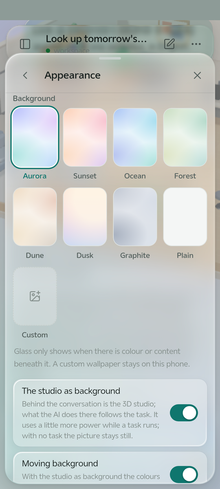
</p>

- **Liquid-glass interface.** The top bar, composer and menus are glass that refracts light, with light-catching rims; twelve backgrounds or your own wallpaper, five accent colours, light/dark themes and spring-based motion (panels can be dragged closed and follow the system's reduce-motion setting) — or a plain standard style. The quick tasks above the input are yours to edit, and the menu has a search box for features and settings.
- **Simplified Chinese, Traditional Chinese, English, Japanese and Korean.** The interface follows the system language or can be switched at any time.
- **Ask from anywhere.** The floating bubble (operate phone, new chat, ask by voice, circle to ask, voice note; drag it onto the × at the bottom to hide it), an "Ask Agent" quick settings tile, home screen widgets (quick ask, task status, quick tasks), app icon shortcuts, and asking about a photo.
- **App lock.** Optionally lock the app with a fingerprint, face or the screen lock.
- **TalkBack.** A finished reply and an approval to give are each read once.

### More tools

- **Alarms, timers and calendar.** Say "wake me at 7 tomorrow" or "remind me in 20 minutes" and the agent sets it in the system Clock app; with calendar access it can also list and add events.
- **Built-in browser.** The agent uses the phone's WebView to open pages, read sites that need JavaScript, click, fill in forms and take screenshots, asking your approval before opening pages and clicking.
- **Background services and long commands.** Web servers, bots and other programs the agent starts keep running, with output and controls on the Background services page; installs and builds can run for up to 30 minutes with live output.
- **Optional developer toolchain.** A pinned Alpine toolchain (Git, Python, Node, Pyright, SSH, tmux) installs on demand and runs in an isolated PRoot process.
- **Offline speech recognition.** With the SenseVoice Small speech model (about 239 MB) downloaded, the microphone recognises Chinese, English, Japanese, Korean and Cantonese on the phone without uploading audio, and the agent can transcribe recordings and videos in the workspace into timestamped text. A voice note records a meeting or a thought and turns it into minutes saved to the workspace and the knowledge base. Replies can be read aloud, and a voice conversation goes back and forth hands-free.
- **Phone status and personal tools.** Read and set volume, brightness and Do Not Disturb and control playback; with your permission, look up contacts and the current location; draft a text message in the Messages app for you to send. When a message for a cloud model holds an ID card or bank card number, it can be answered by the on-device model instead, masked, or sent as is; a message sent with no network waits and goes out once the phone is online (also with the app in the background), or the on-device model answers it.
- **App check.** Lists the apps you installed that hold large powers (device admin, accessibility, reading notifications or SMS and so on), have no home-screen icon or did not come from an app store, sorted into Act on this and Worth a look with the reasons; buttons open Android's own uninstall confirmation or the settings page that takes a power back. With Record where pop-ups come from on, it notes which app came to the front when you had not tapped it, or covered most of the screen with a floating window. About every 30 minutes it looks again in the background and sends a notification when a newly installed app holds large powers, or an app newly gets device admin, accessibility or the like. The AI can run the check too; removing an app or taking back a power is asked every time.
- **Quick to start, recovers on its own.** A cold start takes about 3 seconds; if Android stops the engine, the app restarts it and reconnects; logs can be exported with secrets removed — shared, saved, or sent as a GitHub issue — even from the loading screen when the app cannot start.

## Quick Start

1. Install the APK and open it. The first launch prepares the built-in Python runtime.
2. Open the menu (⋯) → **Provider & API settings** to enter a cloud provider and API key, or **Local models** to download a model that runs on the phone. For Ollama on a computer in your network, see [above](#ollama-on-your-local-network).
3. Type a task, or tap one of the quick tasks. Tap the model chip under the input to switch the model and set the reasoning effort; the shield sets the execution mode (green: workspace, yellow: YOLO, red: full access).
4. While the task runs, type to add instructions, or tap stop. Generated files appear under the reply.
5. For phone control, turn on the app's accessibility service in system settings, then turn on the floating bubble under Menu → **Global entry**. If after an update or a crash accessibility is switched on but does nothing, the Device & tools page says so; turn it off and on again in system settings. On a phone where you ran `adb shell pm grant com.agentworkspace.mobile android.permission.WRITE_SECURE_SETTINGS`, one tap there restarts it.

## Tech Stack

| Layer | Technology |
|---|---|
| App shell | Kotlin, Android WebView, foreground service, WorkManager |
| Interface | HTML / CSS / JavaScript (no framework), SVG-filter refraction for the glass style |
| Agent engine | Python 3.12 embedded with Chaquopy, running the shared `agent_workspace` core in its own process |
| Local inference | llama.cpp (pinned revision) through JNI; CPU by default, with an ARMv8.2 dot-product build chosen per chip; OpenCL acceleration on Adreno 7-series and newer GPUs (in testing) |
| Phone control | Accessibility service; on-screen text recognition with ML Kit (offline) |
| Storage | SQLite event store in app-private storage; credentials encrypted with Android Keystore |
| Optional tools | PRoot launcher with a pinned Alpine 3.22 toolchain |

## Build from Source

Prerequisites: JDK 17, Python 3.12, [uv](https://docs.astral.sh/uv/), Android SDK 36 with NDK 27.3.13750724 and CMake 3.22.1.

```bash
git clone https://github.com/WhitePepperLambSoup/agent-workspace-android.git
cd agent-workspace-android
uv sync --frozen --python 3.12.10

# Download and verify pinned inputs (llama.cpp source, launchers, licences) and package app assets
uv run python "for Android/build_release.py" --prepare-only

# Debug APK (point the build at the Python 3.12 interpreter)
export AGENT_WORKSPACE_BUILD_PYTHON="$(uv run python -c 'import sys; print(sys.executable)')"
cd "for Android/kotlin_app" && ./gradlew assembleDebug
```

The bundled Markdown renderer and icons (`web_companion/static/mobile-vendor.js`) are committed; to regenerate them, install Node.js 22 and run `npm ci --prefix "for Android" --ignore-scripts` then `npm --prefix "for Android" run build:vendor`.

A signed release needs your own keystore in four environment variables — `AGENT_ANDROID_KEYSTORE`, `AGENT_ANDROID_KEY_ALIAS`, `AGENT_ANDROID_STORE_PASSWORD`, `AGENT_ANDROID_KEY_PASSWORD` — and then `uv run python "for Android/build_release.py" --signed`. See [the build and release guide](for%20Android/10_APK_BUILD_AND_RELEASE_GUIDE.md).

## Directory Layout

```
agent-workspace-android/
├── for Android/
│   ├── kotlin_app/          Android project: WebView host, native bridges, accessibility, JNI llama.cpp
│   ├── web_companion/       App interface (HTML/CSS/JS), copied into the APK at build time
│   ├── mobile_*.py          Mobile gateway, task controller, workspaces, model manager
│   ├── skills/              Official skills
│   ├── training/            Fine-tuning source and frozen synthetic datasets (no weights)
│   └── docs/                Design notes, plans and reviews
├── src/agent_workspace/     Shared agent engine (runner, tools, providers, storage)
└── docs/screenshots/        Images used in this README
```

## Privacy and Security

- Conversations, files and settings stay in the app's private storage on your phone. Model requests go to the provider you configure, or stay on the phone with a local model.
- API keys are stored encrypted with Android Keystore and are never shown back in the interface.
- The engine listens only on `127.0.0.1`, requires a per-launch token, and proves its identity to the app before the token is handed over.
- Providers need HTTPS by default (addresses on the phone itself excepted). With Allow local network HTTP checked, http is allowed for private IP addresses only; host names and public addresses still need HTTPS.
- Diagnostic logs are only created and shared when you tap the button; the engine token and API keys are masked.
- Memory stays on the phone and never holds passwords, keys, verification codes or ID numbers; you can review, delete or turn it off at any time. App notes stay on the phone as well and never hold typed text or anything with long numbers in it.
- A notification reply sends a message as you, so each one needs your approval. Sub-tasks do not read location, contacts, calendar or notifications, and cannot operate the phone.
- Knowledge base documents stay on the phone. With a cloud model, the passages found for a question are sent to your provider along with it; to avoid that, turn off "Attach relevant passages to each question" or use an on-device model. Passages are marked as reference material for the model, not as instructions.
- The built-in browser exposes no app interface to web pages, opens only http/https pages and keeps its sign-ins apart from the app's interface; its data can be cleared in one tap.
- The system permissions behind notification rules, the notification digest and the floating bubble are requested only when you turn those features on; notification rules read only the apps you chose and pass a notification's content only to the task it triggers; notifications kept for digests stay on the phone and are cleared as soon as the digest is turned off.
- Phone-control step screenshots stay on the phone for the latest 20 tasks and at most 7 days; screens with passwords or other sensitive content are not captured.
- A home-screen tool runs in a page of its own with no app interface, and all its network requests are blocked; what each tool saves belongs to it alone and is cleared when the tool is removed.
- Background mode needs Shizuku to grant the app higher system permissions; turn it on only on your own phone, and when you do not use it, stop the service in Shizuku and turn off wireless debugging in the developer options.
- In elder mode the older person is never asked to approve anything; what scams commonly need and what cannot be undone is refused automatically, and payments and transfers are never made in any mode. Adding banking and payment apps to Apps the agent may not use is recommended.
- The app check reads only what Android reports about apps (source, permissions and special access) and scans no files; the pop-up record keeps only the app and the time, for 7 days, on the phone, and is cleared when turned off.
- Backups never contain API keys; a backup with a passphrase is encrypted with AES-256 and cannot be opened without it.
- File history stays on the phone, for 30 days and 300 MB at most; the workspace's internal folders and key files are not kept.
- Deleting a conversation erases its messages, tasks and images from the phone and cannot be undone; files it created in the workspace stay.
- Offline speech recognition processes audio on the phone only; recordings are neither uploaded nor kept. Circle to ask sends only the screenshot you circled to the model, and takes no screenshot while a password field is on screen.

## Known Limitations

- Android and phone makers may still freeze or stop background work; the app recovers when reopened, but a task interrupted at that moment needs to be resumed. Background services stop when the engine restarts; those marked "Start with the engine" run again.
- System Settings and some other screens hide the floating bubble; open the window in another app first and ask the agent to open Settings.
- The built-in browser is a WebView that is not on screen, so the few pages that draw only on animation frames may render incompletely, and some phones cannot capture it as an image; the agent then reads the page text instead.
- On-device models run mainly on the CPU, so speed depends heavily on the phone. GPU acceleration supports only Adreno 7-series and newer chips and has not been tested on such a phone yet; the GPU compatibility report under Device & tools can be filed as a GitHub issue; other GPUs such as Mali use the CPU. For reference, Qwen3.5 2B on a Snapdragon 888 processes about 28 prompt tokens and generates about 10 tokens per second; after switching to an on-device model the first conversation takes about a minute to start answering, later ones about 1–2 seconds; long tasks such as rewriting a whole web page or analysing a file of tens of KB take from ten to several tens of minutes, and slow down when the phone gets hot. 2B needs about 1.8 GB of available memory; phones with less should use 0.8B.
- Small models handle questions, reading, writing, copying and appending to files and simple pages; for complex edits their code is often incomplete, and documents in a strict format (JSON, CSV, HTML) often come out wrong, so check them or use a cloud model.
- Without the search-by-meaning model, the knowledge base searches by keyword only: a question worded completely differently, outside the synonym list, may miss the relevant passage; add your own synonyms on the Knowledge base page. Scanned pages are read with offline text recognition, so names and numbers in them may be misread.
- While the app is in the background, Android does not let it open the system Clock app, so alarms and timers arrive as a notification that you tap to finish.
- Offline speech recognition runs on 64-bit ARM phones only; x86_64 devices use the system recogniser.
- Launchers do not let a widget blur the wallpaper behind it, so the glass-style widgets approximate the look with translucency and highlights.
- Web search uses the free DuckDuckGo and Bing pages, so results and availability depend on your network; some phrasings return nothing, and the agent then rephrases.
- Background mode is experimental: an app cannot be used in front and in the background at the same time, sound from an app in the background plays from the phone's speaker, and Shizuku has to be started again after the phone restarts.
- Android does not let an app remove a home-screen icon: after a home-screen tool is removed, its icon turns grey and can be removed with a long press.
- The app check is not a virus scan: it looks only at what Android reports and does not recognise specific malware.
- Elder mode starts a fresh conversation each day, so the previous day's conversation is not in it; what should be remembered goes to memory.
- Some makers' auto-start control blocks the accessibility service: when Settings shows it on but it does nothing, allow the app to auto-start, then turn the service off and on again.
- The English interface text was written by the developer; corrections are welcome. The Japanese and Korean text is new, and corrections from native speakers are especially welcome.
- When privacy routing has the on-device model answer a message in an ordinary conversation, the first answer reads a long system prompt once: about 20 minutes on a Snapdragon 888, about 20 seconds after that.
- Gemma 4 E2B needs about 3.5 GB of free memory; on a phone with less, it only runs in the extended memory mode with a manually set context, and slowly.

## License

Apache License 2.0 — see [LICENSE](LICENSE). Third-party components and their licences are listed in [THIRD_PARTY_NOTICES.md](for%20Android/THIRD_PARTY_NOTICES.md).
