[English](README.md) | [简体中文](README.zh-CN.md)

# Agent Workspace 安卓版

在安卓手机上运行的 AI Agent。它能规划并执行多步骤任务，调用真实的工具：文件、PDF、网页搜索、可选的 Linux 工具链和安卓系统操作；开启无障碍服务后，还能按你的要求操作手机上的其他应用。模型可以用你选择的云端服务、局域网电脑上的 Ollama，或完全在手机上运行的本地模型。全部打包在一个 APK 里，不需要 Termux，也不需要 root。

<p align="center">
  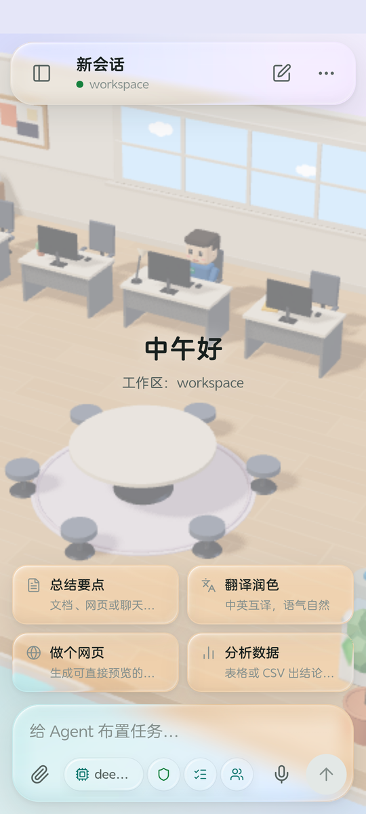
  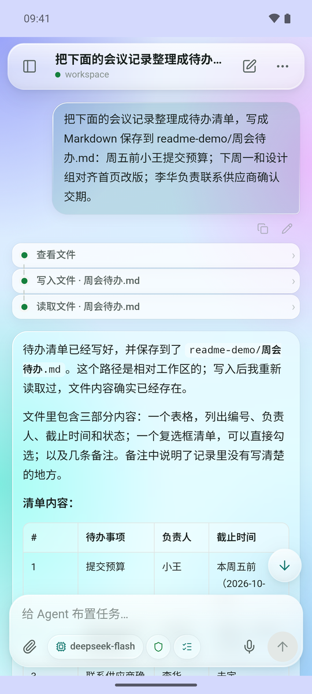
  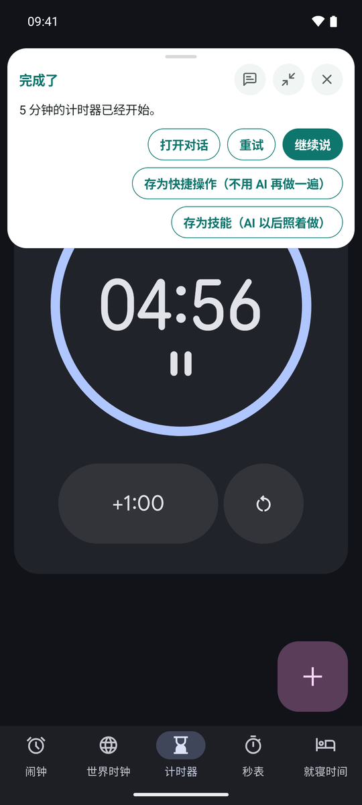
</p>

## 下载

在 [Releases](https://github.com/WhitePepperLambSoup/agent-workspace-android/releases) 下载 `AgentWorkspace_2.0.2_android.apk` 安装即可，SHA-256 写在发布说明里。之后的版本可在应用内更新（菜单 →「关于与更新」，或加载页的「检查更新」）。各版本的改动见 [CHANGELOG](CHANGELOG.md)。

- 需要 Android 8.0（API 26）及以上，64 位 ARM（`arm64-v8a`）或 `x86_64`；纯 32 位系统的手机无法安装。
- 界面由系统的 Android System WebView 显示，需要 Chrome 80 及以上的内核。WebView 被停用、缺失或过旧时，应用会说明原因并引导到应用商店更新。
- 支持 Android 15+ 的 16 KB 内存页机型、折叠屏、分屏和外接键盘；在系统或厂商的「强制深色」下也保持应用自己的配色。
- 安装包约 73 MB；本地模型和离线语音模型是应用内的可选下载。

2.0.2 的改动：模型设置里可以勾选「允许局域网 HTTP」，连接局域网电脑上的 Ollama（见[连接局域网电脑上的 Ollama](#连接局域网电脑上的-ollama)）；模型把卡片写成 `json` 代码块时也显示为卡片；修复部分手机上原生对话框没有背景、切换界面语言后操作手机小窗仍是旧语言的问题。

## 功能

### 对话与多步骤任务

<p align="center">
  
  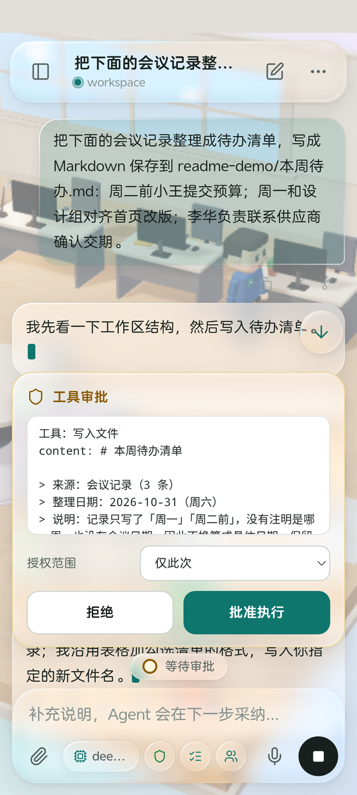
  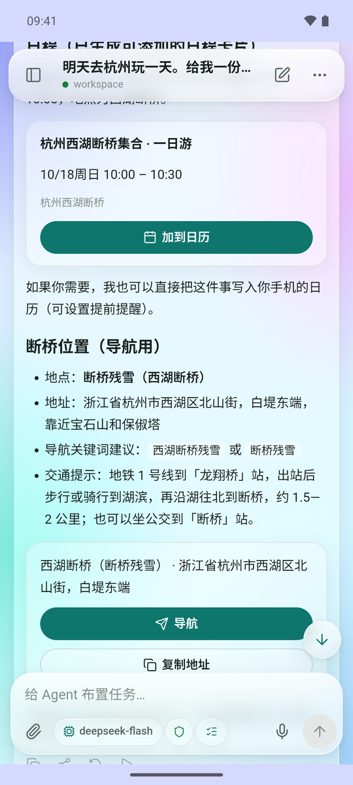
</p>

- **多步骤任务**：Agent 自己规划、调用工具，每一步实时可见——流式回复、思考过程，以及每个工具调用的「执行中 / 已完成 / 失败 / 已取消」。生成的文件显示在回复下方，可以直接打开、分享或另存。
- **任务中途插话**：任务执行时直接输入，消息会加入当前任务，Agent 在下一步采纳，不用从头再来。
- **审批**：三种执行模式（仅工作区 / YOLO / 完全访问），敏感操作前弹出审批，可以只允许这一次，也可以允许本任务内的同类操作；删除文件、写入长期记忆和在对话里操作其他应用仍逐次询问。
- **回复里的卡片**：清单可以勾选，对比表并排列出选项，日程卡片一键加到日历，地点卡片一键导航，「下一步」卡片点一下就发出对应的要求。
- **模型与思考程度**：点输入框里的模型按钮，在常用的模型配置之间切换，用滑杆调思考程度；云端模型之间切换不重启引擎。消息可以编辑后重发，回复可以重新生成，对话可以归档或彻底删除。
- **公式与流程图**：回复中的 LaTeX 公式和 Mermaid 流程图直接渲染。
- **计划模式与技能**：计划模式下 Agent 只看不改，先给计划，你同意后再执行；「技能」页安装官方技能或导入 SKILL.md，Agent 需要时才读取。

### 操作手机

需要在系统设置里手动开启本应用的无障碍服务。在任何应用里点悬浮球的「操作手机」，在弹出的小窗里写下要做的事，Agent 看屏幕、点按、滑动、输入、按名字打开应用，每一步显示在小窗里。

<p align="center">
  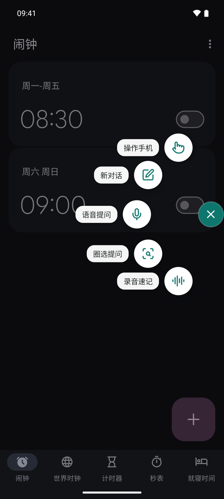
  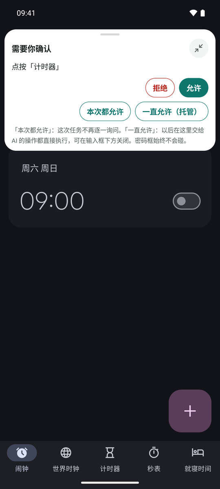
  
</p>

- **确认方式**：需要确认的操作在小窗里询问，可以选「允许」「本次都允许」或「一直允许（托管）」；托管有步数和时间上限。可以随时刷新、暂停、停止或重试。
- **安全规则**：付款、转账、下单按钮和支付密码页在任何模式下都不点（规则写在应用里）；删除、清除类按钮先停下来询问；密码框和锁屏不碰。网页、通知或屏幕上出现像是写给 AI 的指令时，本任务的托管授权立即失效，之后每一步都询问。
- **回看操作**：每一步保留一张缩略截图，任务结束后可以逐步回看。截图只存在手机上，保留最近 20 个任务、最多 7 天，有密码等敏感内容的画面不截。
- **快捷操作**：做完的事可以存成快捷操作，以后不经过模型，按记下的步骤直接执行；步骤可以编辑，可以定时运行或设成自动触发。应用改版导致某一步卡住时，Agent 从那一步接着做完，再一键更新快捷操作。快捷操作可以导出成分享码，导入前逐步列出它要做什么。
- **圈选即操作**：圈出屏幕上的一块，在手机上离线识别文字后给出可做的事：拨号、打开链接、导航、加到日历、比价、翻译、存进知识库或复制文字；也可以把圈出的部分发给 Agent 提问。屏幕上有密码框时不截图。

<p align="center">
  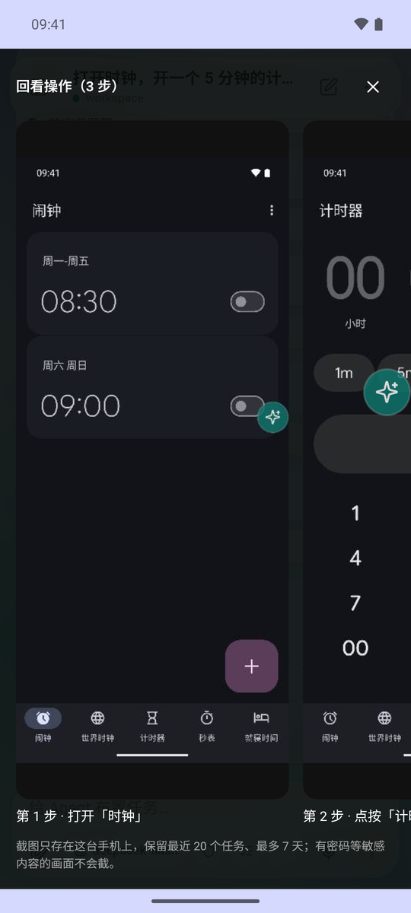
  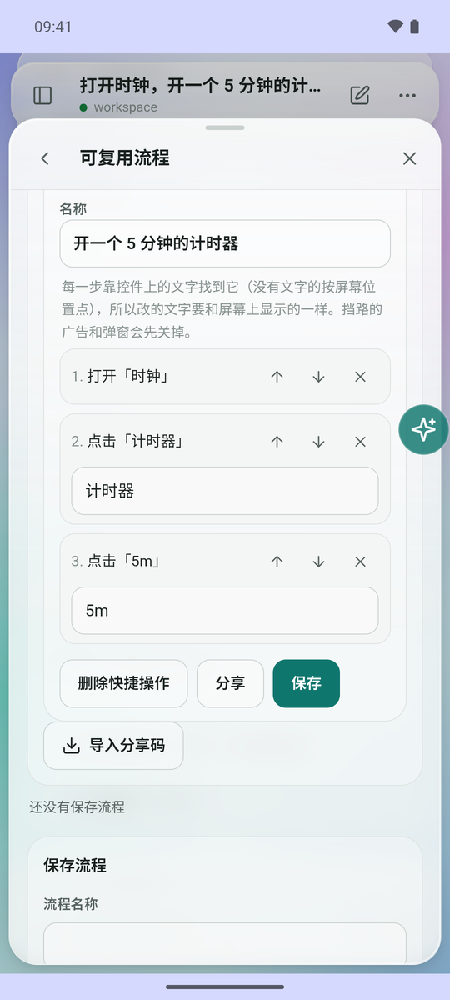
  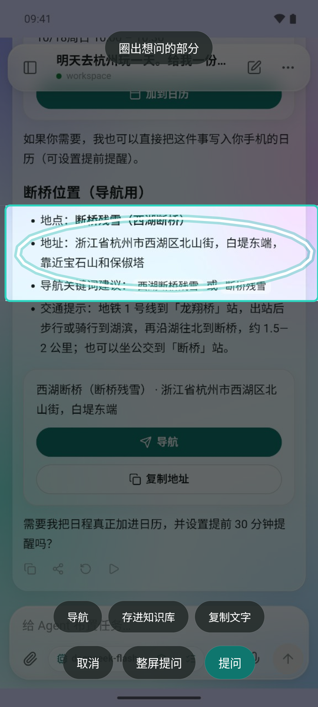
</p>

### 通知摘要、早报与自动化

<p align="center">
  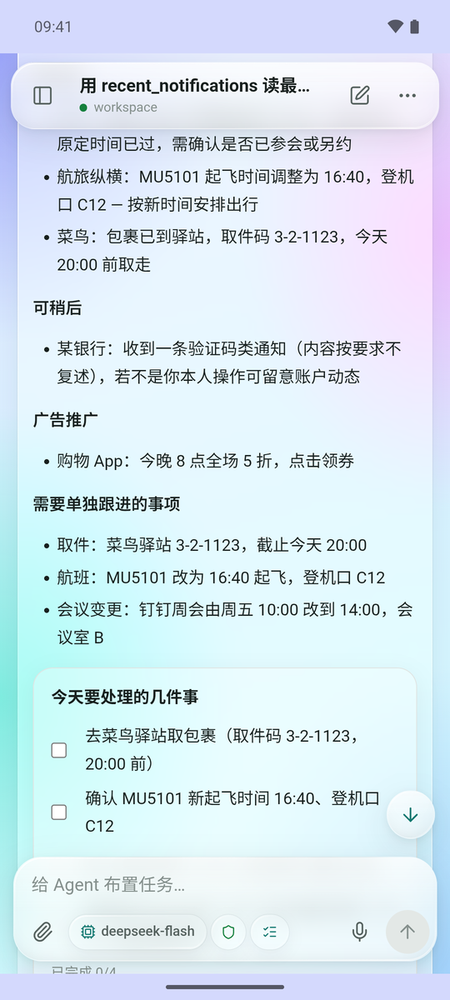
</p>

- **通知摘要**：打开「记录通知用于摘要」后，收到的通知只记在手机上，保留 48 小时；需要时整理成「要处理」「可稍后」「广告推广」，取件码、航班车次、会议变更和账单到期单独列成清单；验证码不复述。可以设成每 2 小时整理一次。
- **每日早报**：日程、天气、录音要点和待办；桌面 AI 卡片显示定时任务最近一次的结果。
- **定时任务与自动触发**：定时任务在默认的「仅工作区」模式下也能运行；可以在开始充电、连上 Wi‑Fi、打开某个应用时触发，也可以由 Tasker 等外部应用发起。
- **通知触发**：选定应用的通知到达时，按你写的要求处理，例如记下快递取件码；默认每次先问你。
- **可复用流程**：保存常用的流程，可以回放步骤；还有任务评测和跨设备接力。

### 模型

<p align="center">
  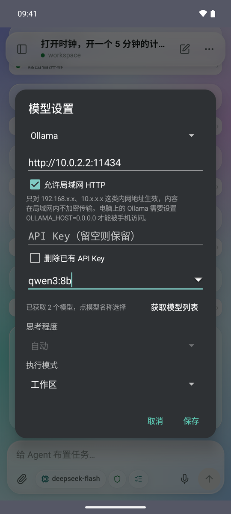
</p>

- **云端服务**：OpenAI 兼容接口（OpenAI、DeepSeek、通义千问、Kimi、智谱 GLM、xAI 等）、Anthropic、Gemini 和 Ollama。使用 DeepSeek、OpenAI、Kimi、通义千问、智谱 GLM、Gemini、Grok、OpenRouter 或 Claude 时，每次请求只在末尾追加内容，服务商的上下文缓存能覆盖大部分输入（DeepSeek 在手机上的长任务约 95%），缓存部分按更低的价格计费。
- **局域网里的 Ollama**：勾选「允许局域网 HTTP」后，可以用 http 连接 192.168.x.x、10.x.x.x、172.16–31.x.x 这类内网地址上的 Ollama 等服务，设置方法见下一节。
- **本机模型**：下载 Qwen3 / Qwen3.5 GGUF 模型，通过 llama.cpp 在手机 CPU 上离线运行，Qwen3.5 支持图片输入。新对话首字约 1–2 秒；支持点积指令的芯片自动使用加速版，手机发热时自动降速。模型可从 ModelScope 魔搭（国内 CDN）或 Hugging Face 下载，暂停后可换来源续传；工具调用有语法约束，小模型不会写出格式错误的调用。
- **按用途分配模型**：操作手机、整理长对话摘要可以分别用更便宜的模型；服务商可以加自定义请求头和备用 API Key（出错自动切换）。

#### 连接局域网电脑上的 Ollama

1. 让电脑上的 Ollama 监听局域网：设置环境变量 `OLLAMA_HOST=0.0.0.0`，然后重启 Ollama。
   - Windows：在「系统属性 → 环境变量」里新建用户变量 `OLLAMA_HOST`，值为 `0.0.0.0`，退出托盘里的 Ollama 再重新打开。
   - macOS：运行 `launchctl setenv OLLAMA_HOST 0.0.0.0`，再重启 Ollama 应用。
   - Linux（systemd）：`sudo systemctl edit ollama.service`，在 `[Service]` 下加 `Environment="OLLAMA_HOST=0.0.0.0"`，然后 `sudo systemctl restart ollama`。
2. 查到电脑的局域网 IP，例如 `192.168.1.5`；电脑的防火墙需要放行 11434 端口。
3. 在手机上打开菜单（⋯）→「服务商与 API 设置」，服务商选 Ollama，地址填 `http://192.168.1.5:11434`，勾选「允许局域网 HTTP」，点「获取模型列表」并选择模型，保存。

这个选项只对内网 IP 生效：`.local` 之类的主机名和公网地址仍然必须使用 HTTPS。手机和电脑不在同一个网络时，可以用 Tailscale 等方式给 Ollama 提供 HTTPS 地址。局域网内的 http 连接不加密，同一网络里的其他设备可以看到对话内容。发往局域网地址的模型请求和发往其他服务商的一样，要经过「网络访问审批」。

### 文件、知识库与记忆

- **工作区与文件**：每个工作区对应一个文件夹。生成的文件可直接打开、预览（Markdown、图片、隔离沙箱中的 HTML）、分享或另存；文本文件可在应用内编辑；文件和文件夹可以重命名、移动、删除和新建；工作区也会出现在系统文件选择器里。
- **分享进来**：从微信、QQ 或任意应用分享文件到对话；在输入框里拍照、选照片或文件，选好就直接进当前对话，大图自动压缩；PDF 按页读取，扫描页自动 OCR。
- **知识库**：把说明书、合同、笔记、电子书（PDF、Word、Excel、EPUB、网页、Markdown、文本）加进来，提问时 AI 从中找出相关段落回答，并注明出自哪份文档、第几页。扫描版 PDF 用手机上的离线文字识别读取；也可以粘贴或分享网页链接，保存网页当时的内容。文档可以分到多个知识库，每个对话选用其中几个。文档只存在手机上，按关键词检索，内置常用同义词并可自定义，不用下载模型，也不消耗额度。
- **记忆**：AI 会有节制地记住你的偏好和常用信息（最多 500 条，按主题整理、可以搜索，相似内容不重复记，不记密码和验证码），在「记忆」页可查看、修改和删除。
- **备份与导出**：会话、记忆、自动化、工作区文件和设置导出为一个 zip，换手机或重装后恢复；单个对话可以导出为 Markdown、PDF 或长图。

### 界面与入口

<p align="center">
  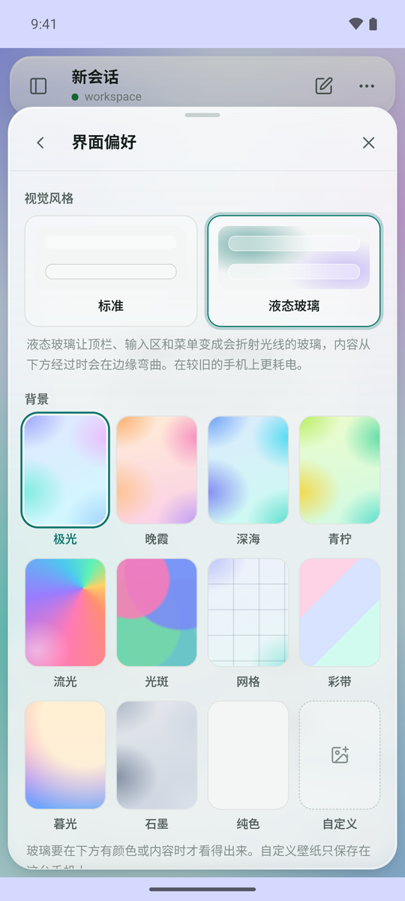
</p>

- **液态玻璃界面**：顶栏、输入区和菜单是会折射光线的玻璃，边缘有高光；十二种背景或自定义壁纸、五种主题色、浅色 / 深色；弹簧曲线动画，面板可以用手指拖着关，跟随系统的「减少动画」设置；也可以选简洁的标准风格。输入框上方的快捷任务可以自定义，菜单顶部可以搜索功能和设置。
- **简体中文、繁体中文和英文界面**：默认跟随系统语言，随时可切换。
- **随处提问**：悬浮球（操作手机、新对话、语音提问、圈选提问、录音速记，拖到底部的 × 即可隐藏）、通知栏的「问 Agent」开关、桌面小组件（快捷提问、任务动态、常用任务）、长按桌面图标的快捷方式，以及拍照提问。
- **应用锁**：可选用指纹、面容或锁屏密码给应用上锁。

### 其他工具

- **闹钟、计时与日历**：说「明早 7 点叫我」「20 分钟后提醒我」，AI 在系统时钟里设好闹钟或计时；允许访问日历后，还能查看和添加日程。
- **内置浏览器**：AI 用手机自带的 WebView 打开网页、读取需要脚本渲染的页面、点击、填表和截图，打开网页和点击前需要你批准。
- **后台服务与长时间命令**：AI 启动的网页服务、机器人等可以一直运行，在「后台服务」页查看和停止；安装、编译最长可运行 30 分钟并实时显示输出。
- **可选开发工具链**：按需安装固定版本的 Alpine 工具链（Git、Python、Node、Pyright、SSH、tmux），在隔离的 PRoot 进程中运行。
- **离线语音识别**：下载 SenseVoice Small 语音模型（约 239 MB）后，麦克风在手机上识别中、英、日、韩和粤语，录音不上传；AI 也能把工作区里的录音和视频转成带时间戳的文字。「录音速记」录下会议或想法，整理成纪要，保存到工作区并加入知识库。回复可以朗读，也可以连续语音对话。
- **手机状态与个人信息**：读取和调整音量、亮度、勿扰，控制播放；你允许后查联系人和当前位置；在短信应用里填好短信由你发送。发给云端模型前发现身份证号、银行卡号会先提醒，可以遮盖后发送。
- **启动与恢复**：冷启动约 3 秒；安卓停掉引擎后，应用会自动重启引擎并重新连接；日志可导出（分享、保存或提交为 GitHub Issue），密钥会被隐藏；进不去应用时也能在加载页导出。

## 快速开始

1. 安装 APK 并打开，首次启动会初始化内置的 Python 运行环境。
2. 打开菜单（⋯）→「服务商与 API 设置」填写云端服务和 API 密钥，或进入「本地模型」下载一个在手机上运行的模型。用局域网电脑上的 Ollama 见[上文](#连接局域网电脑上的-ollama)。
3. 输入任务，或点一个快捷任务。点输入框下方的模型芯片可切换模型、调思考程度；盾牌图标是执行模式（绿色：仅工作区，黄色：YOLO，红色：完全访问）。
4. 任务执行中可以继续输入补充要求，也可以点停止。生成的文件显示在回复下方。
5. 要操作手机：在系统设置里开启本应用的无障碍服务，再到菜单 →「全局入口」打开悬浮球。

## 技术栈

| 层 | 技术 |
|---|---|
| 应用外壳 | Kotlin、Android WebView、前台服务、WorkManager |
| 界面 | 原生 HTML / CSS / JavaScript（无框架），液态玻璃用 SVG 滤镜实现折射 |
| Agent 引擎 | 通过 Chaquopy 内嵌的 Python 3.12，在独立进程中运行共享的 `agent_workspace` 核心 |
| 本地推理 | 固定版本的 llama.cpp，经 JNI 调用，仅用 CPU；ARMv8.2 点积加速版按芯片自动选用 |
| 操作手机 | 无障碍服务；屏幕文字识别用 ML Kit（离线） |
| 存储 | 应用私有目录中的 SQLite 事件库；凭据由 Android Keystore 加密 |
| 可选工具 | PRoot 启动器 + 固定版本的 Alpine 3.22 工具链 |

## 从源码构建

需要：JDK 17、Python 3.12、[uv](https://docs.astral.sh/uv/)、Android SDK 35（含 NDK 27.3.13750724 与 CMake 3.22.1）。

```bash
git clone https://github.com/WhitePepperLambSoup/agent-workspace-android.git
cd agent-workspace-android
uv sync --frozen --python 3.12.10

# 下载并校验固定版本的构建输入（llama.cpp 源码、启动器、许可证），打包应用资源
uv run python "for Android/build_release.py" --prepare-only

# Debug APK（让构建使用 Python 3.12 解释器）
export AGENT_WORKSPACE_BUILD_PYTHON="$(uv run python -c 'import sys; print(sys.executable)')"
cd "for Android/kotlin_app" && ./gradlew assembleDebug
```

界面用到的 Markdown 渲染器和图标（``web_companion/static/mobile-vendor.js``）已随源码提交；如需重新生成，安装 Node.js 22 后运行 ``npm ci --prefix "for Android" --ignore-scripts`` 和 ``npm --prefix "for Android" run build:vendor``。

签名的正式版需要你自己的 keystore，通过四个环境变量提供——`AGENT_ANDROID_KEYSTORE`、`AGENT_ANDROID_KEY_ALIAS`、`AGENT_ANDROID_STORE_PASSWORD`、`AGENT_ANDROID_KEY_PASSWORD`——然后运行 `uv run python "for Android/build_release.py" --signed`。详见[构建与发布指南](for%20Android/10_APK_BUILD_AND_RELEASE_GUIDE.md)。

## 目录结构

```
agent-workspace-android/
├── for Android/
│   ├── kotlin_app/          安卓工程：WebView 宿主、原生桥、无障碍、JNI llama.cpp
│   ├── web_companion/       应用界面（HTML/CSS/JS），构建时复制进 APK
│   ├── mobile_*.py          移动网关、任务控制器、工作区、模型管理
│   ├── skills/              官方技能
│   ├── training/            本地模型微调源码与冻结的合成数据集（不含权重）
│   └── docs/                设计、计划与审查文档
├── src/agent_workspace/     共享的 Agent 引擎（执行器、工具、模型接入、存储）
└── docs/screenshots/        本说明使用的截图
```

## 隐私与安全

- 对话、文件和设置保存在手机上的应用私有目录。模型请求只发往你配置的服务商；使用本地模型时不出手机。
- API 密钥由 Android Keystore 加密保存，界面上不会再显示。
- 引擎只监听 `127.0.0.1`，每次启动使用新的访问令牌，并在交出令牌前向应用证明身份。
- 连接服务商默认要求 HTTPS（本机地址除外）。勾选「允许局域网 HTTP」后，http 只对内网 IP 放行，主机名和公网地址仍要求 HTTPS。
- 诊断日志只在你点按钮时生成和分享，引擎令牌和 API 密钥会被隐藏。
- 记忆只保存在手机上，不会记住密码、密钥、验证码或证件号；可以随时查看、删除或关闭。
- 知识库文档只保存在手机上。使用云端模型时，检索到的相关段落会随问题发给你配置的服务商；不想发送时可关闭「提问时自动附上相关段落」，或改用本机模型。这些段落会标明是参考资料，而不是给 AI 的指令。
- 内置浏览器不向网页暴露任何应用接口，只能打开 http / https 网页，登录状态与应用界面分开保存，可一键清除。
- 通知触发、通知摘要、悬浮球所需的系统权限只在你打开对应功能时才请求；通知触发只读取你选定应用的通知，通知内容只交给被触发的任务；通知摘要记下的通知只存在手机上，关闭后立即清空。
- 操作手机的每步截图只存在手机上，保留最近 20 个任务、最多 7 天；有密码等敏感内容的画面不截。
- 备份文件不含 API 密钥。
- 删除对话会从手机上彻底清除它的聊天记录、任务和图片，无法恢复；它在工作区里生成的文件会保留。
- 离线语音识别的录音只在手机上处理，不上传也不保存。圈选提问只把你圈出的截图发给模型；屏幕上有密码框时不截图。

## 已知限制

- 安卓系统和手机厂商仍可能冻结或停止后台运行；重新打开应用会自动恢复，但当时被中断的任务需要手动恢复。后台服务在引擎重启时会停止，勾选「随引擎启动」的会自动重新运行。
- 系统设置等页面会隐藏悬浮球，可以先在别的应用里呼出小窗，再让 AI 打开设置去做。
- 内置浏览器是不显示在屏幕上的 WebView，依赖动画帧渲染内容的少数网页可能显示不全；个别机型不能给它截图，这时 AI 会改为读取页面文字。
- 本地模型只用 CPU 运行，速度很依赖手机性能。参考：骁龙 888 上的 Qwen3.5 2B 输入约 28 Token/秒、生成约 10 Token/秒；换用本机模型后的第一个对话首字约 1 分钟，之后的新对话约 1–2 秒；改写整个网页、分析几十 KB 的文件这类长任务需要十几到几十分钟，手机发热时会自动降速。2B 需要约 1.8 GB 可用内存，内存较小的手机建议用 0.8B。
- 小模型适合问答、读写、复制和追加文件以及简单网页；复杂修改时写出的代码常常不完整，严格格式的文档（JSON、CSV、HTML）也常常出错，需要检查或换用云端模型。
- 知识库按关键词检索，不理解语义：同义词表之外、用词完全不同的提问可能找不到相关段落，可以在知识库页补充同义词。扫描版 PDF 用离线文字识别读取，人名和数字可能识别错误。
- 应用在后台时，安卓不允许直接打开系统时钟，设闹钟和计时会改为发通知，需要点一下才会生效。
- 离线语音识别只支持 64 位 ARM 手机；x86_64 设备使用系统语音识别。
- 桌面不允许小组件模糊背后的壁纸，玻璃样式的小组件是半透明加高光的近似效果。
- 网页搜索使用免费的 DuckDuckGo 和必应，结果和可用性取决于所在网络；个别说法可能搜不到结果，AI 会换个说法再搜。
- 英文界面文案由开发者撰写，欢迎指正。

## 许可证

Apache License 2.0，见 [LICENSE](LICENSE)。第三方组件及其许可证见 [THIRD_PARTY_NOTICES.md](for%20Android/THIRD_PARTY_NOTICES.md)。
