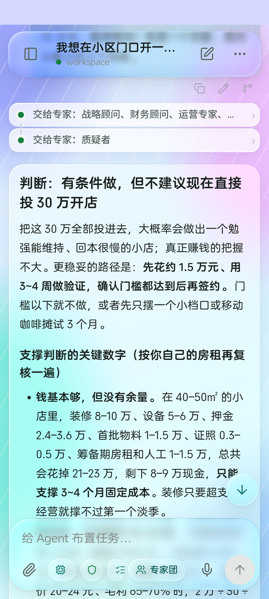
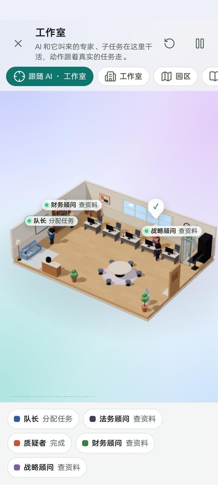
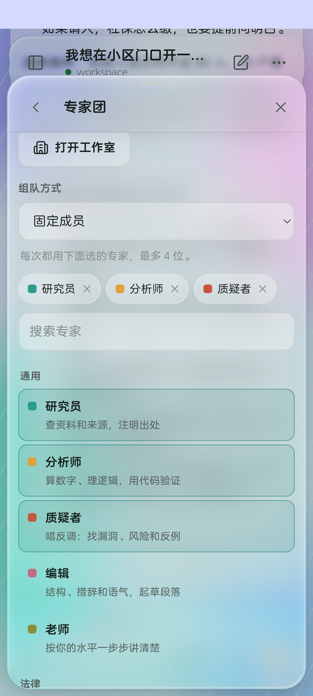
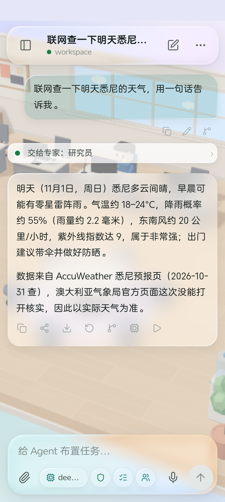
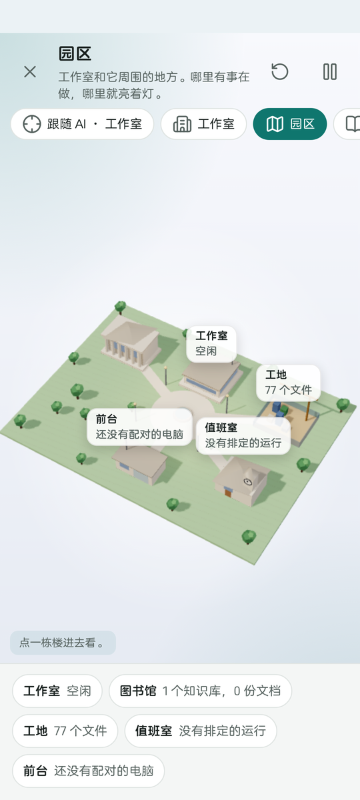
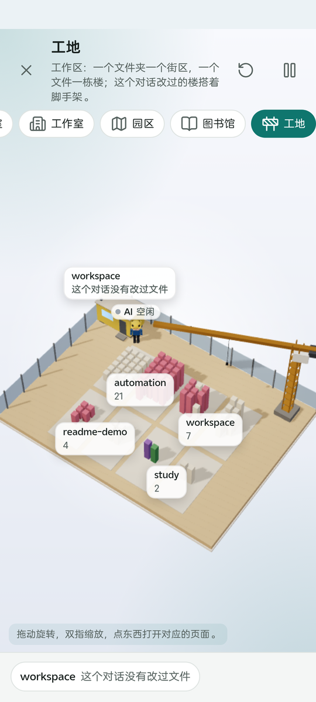
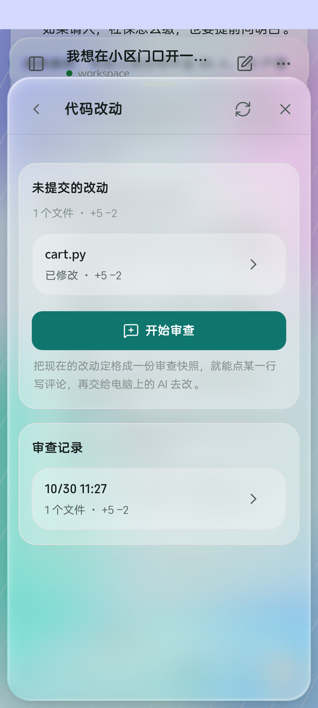
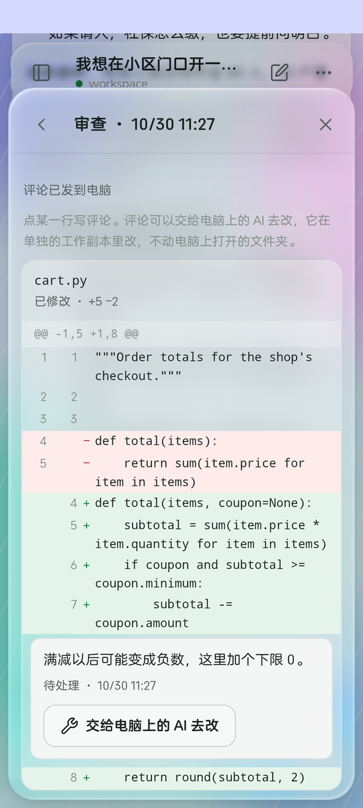

[English](README.md) | [简体中文](README.zh-CN.md)

# Agent Workspace 安卓版

> 电脑版：[agent-workspace-desktop](https://github.com/WhitePepperLambSoup/agent-workspace-desktop)（Windows）。手机和电脑配对后可以互相交任务、传文件、接力对话，见[连接电脑版](#连接电脑版)。

在安卓手机上运行的 AI Agent。它能规划并执行多步骤任务，调用真实的工具：文件、PDF、网页搜索、可选的 Linux 工具链和安卓系统操作；开启无障碍服务后，还能按你的要求操作手机上的其他应用。模型可以用你选择的云端服务、局域网电脑上的 Ollama，或完全在手机上运行的本地模型。全部打包在一个 APK 里，不需要 Termux，也不需要 root。

<p align="center">
  
  
  
</p>

## 下载

在 [Releases](https://github.com/WhitePepperLambSoup/agent-workspace-android/releases) 下载 `AgentWorkspace_2.7.1_android.apk` 安装即可，SHA-256 写在发布说明里。之后的版本可在应用内更新：应用每次打开和大约每 12 小时会自动检查，也可以在菜单 →「关于与更新」或加载页的「检查更新」手动检查。各版本的改动见 [CHANGELOG](CHANGELOG.md)。

- 需要 Android 8.0（API 26）及以上，64 位 ARM（`arm64-v8a`）或 `x86_64`；纯 32 位系统的手机无法安装。
- 界面由系统的 Android System WebView 显示，需要 Chrome 80 及以上的内核。WebView 被停用、缺失或过旧时，应用会说明原因并引导到应用商店更新。
- 支持 Android 15+ 的 16 KB 内存页机型、折叠屏、分屏和外接键盘；在系统或厂商的「强制深色」下也保持应用自己的配色。
- 安装包约 75 MB；本地模型和离线语音模型是应用内的可选下载。

2.7.1 让工作室背景在滑动和静止时看起来一样，AI 走动时画面更流畅，顶栏新增工作室按钮。2.7.0 换了更安静的界面和新图标。液态玻璃风格下，聊天背后是这个对话的 3D 工作室，AI 的动作跟着任务走；工作室外面是园区，能看到知识库、工作区文件、定时任务和配对的电脑。

## 功能

### 对话与多步骤任务

<p align="center">
  
  
  
</p>

- **多步骤任务**：Agent 自己规划、调用工具，每一步实时可见——流式回复、思考过程，以及每个工具调用的「执行中 / 已完成 / 失败 / 已取消」。生成的文件显示在回复下方，可以直接打开、分享或另存。
- **任务中途插话**：任务执行时直接输入，消息会加入当前任务，Agent 在下一步采纳，不用从头再来。
- **审批**：三种执行模式（仅工作区 / YOLO / 完全访问），敏感操作前弹出审批，可以只允许这一次，也可以允许本任务内的同类操作；发给模型服务商的请求可以选「以后都允许发给这个服务商」，已信任的服务商可以在「执行权限」页取消；删除文件、写入长期记忆、在对话里操作其他应用和回复通知仍逐次询问。
- **回复里的卡片**：清单可以勾选，对比表并排列出选项，日程卡片一键加到日历，地点卡片一键导航，「下一步」卡片点一下就发出对应的要求。
- **模型与思考程度**：点输入框里的模型按钮，在常用的模型配置之间切换，用滑杆调思考程度；云端模型之间切换不重启引擎。消息可以编辑后重发，回复可以重新生成，对话可以归档或彻底删除。
- **公式与流程图**：回复中的 LaTeX 公式和 Mermaid 流程图直接渲染。
- **计划模式与技能**：计划模式下 Agent 只看不改，先给计划，你同意后再执行；「技能」页安装官方技能或导入 SKILL.md，Agent 需要时才读取。技能可以用带签名的分享码分享，导入前会显示签名人，以及说明里提到的发消息、付款、删除、个人信息等内容。
- **子任务**：一个任务里互不相关的几件事（查几份文档、比较几个选项），Agent 可以分给子任务同时做（每次最多 4 个，同时 3 个），再汇总结果。子任务只能查看文件、知识库、记忆和网页，不能改文件、运行命令或操作手机；每个子任务有自己的对话，在归档里可以打开查看。
- **单个任务上限**：在「模型与思考」里给每个任务设费用和 Token 上限，连同它分出的子任务一起计算，到了就停下并说明是哪一项；「Token 与费用」按对话、摘要压缩和子任务分开统计。发送前，输入框下方按最近的任务估算这条消息大约要花多少。
- **对话分叉**：从任意一条消息分叉出新对话。从你的消息分叉时，新对话保留这条之前的内容，这条消息放回输入框改写；从回复分叉时保留到这条回复为止。原对话不变，新对话里 AI 记得之前的内容，两个对话共用工作区里的文件。
- **换个模型对比**：让当前服务商的另一个模型回答同一个问题，两个回答放在一起看，各自标出模型用时（不含等你批准的时间）和 Token；可以接着用另一个回答继续。

### 专家团

<p align="center">
  
  
  
</p>

- **几位专家分工研究**：点输入框里的「专家团」后发消息，AI 当队长，把问题拆给几位专家同时研究，需要时再请一位专家审阅成稿，最后汇总回答并写明分歧。比普通回答慢、也更费 Token，适合需要多方面判断的问题；需要云端模型。手机上的专家只查资料、读文件和网页，不改文件、不运行命令。
- **专家库**：73 位专家，按领域分组；可以自动组队，也可以固定成员（最多 4 位）或添加自定义专家，写明他负责什么、怎么做。专家可以共用这个对话的知识库，也可以给某位专家单独指定一个。
- **3D 工作室**：队长和专家在工作室里分工、查资料、交稿，动作跟着真实的任务走，见[工作室与园区](#工作室与园区)。
- **随时知道进度**：每位专家在做什么显示在对话和引擎通知里；在其他应用里分享文字到「问专家团」，会打开一个新对话并填好问题。

### 工作室与园区

<p align="center">
  
  
  
</p>

- **聊天背后的工作室**：液态玻璃风格下，聊天背后是这个对话的 3D 工作室，AI 的动作跟着真实的任务走：想事情时站在窗前，查网页在工位上，查知识库去书架，运行命令进玻璃沙箱间，生成的文档去打印机取，等你批准改文件或运行命令时站在玻璃门外；叫来的专家和子任务从门进来，做完从门离开。上面盖一层淡色，文字照样清楚。没有任务时画面静止，切到后台不绘制；性能不够、不支持 WebGL 或开始几秒就掉帧的手机用颜色背景。可以在「界面偏好」里关掉。
- **全屏查看**：点顶栏标题右边的工作室按钮或「去工作室看看」，聊天界面让开，同一个场景可以拖动旋转、双指缩放，点人物打开他的子任务。
- **园区**：全屏时上方一排按钮切到园区和其中各处。图书馆是知识库，一个知识库一个书架，正在读入的文档放在推车上；工地是工作区文件，一个文件夹一个街区，一个文件一栋楼，这个对话改过的搭着脚手架；值班室是定时任务，一个任务一位值班员；前台是配对的电脑，有请求或审批在等你时，那台电脑走到台前。默认跟着 AI 去它干活的地方。点园区里的楼会进去，点里面的东西会打开对应的页面或文件。

### 操作手机

需要在系统设置里手动开启本应用的无障碍服务。在任何应用里点悬浮球的「操作手机」，在弹出的小窗里写下要做的事，Agent 看屏幕、点按、滑动、输入、按名字打开应用，每一步显示在小窗里。

<p align="center">
  
  
  
</p>

- **确认方式**：需要确认的操作在小窗里询问，可以选「允许」「本次都允许」或「一直允许（托管）」；托管有步数和时间上限。可以随时刷新、暂停、停止或重试。
- **安全规则**：付款、转账、下单按钮和支付密码页在任何模式下都不点（规则写在应用里）；删除、清除类按钮先停下来询问；密码框和锁屏不碰。网页、通知或屏幕上出现像是写给 AI 的指令时，本任务的托管授权和这个对话已有的授权立即失效，之后每一步都询问，这个任务里也不再写入记忆、应用经验和技能。
- **回看操作**：每一步保留一张缩略截图，任务结束后可以逐步回看。截图只存在手机上，保留最近 20 个任务、最多 7 天，有密码等敏感内容的画面不截。
- **图文教程**：把一次手机操作做成长图：每一步写明做了什么，点过的位置用红圈标在当时那一屏上，悬浮球这类悬浮窗会被抹掉；说明可以改，步骤可以删，生成后直接分享，方便教家人照着做。
- **快捷操作**：做完的事可以存成快捷操作，以后不经过模型，按记下的步骤直接执行；步骤可以编辑，可以定时运行或设成自动触发。应用改版导致某一步卡住时，Agent 从那一步接着做完，再一键更新快捷操作。快捷操作可以导出成带签名的分享码，导入前显示签名人，并逐步列出它要做什么。
- **圈选即操作**：圈出屏幕上的一块，在手机上离线识别文字后给出可做的事：拨号、打开链接、导航、加到日历、比价、翻译、存进知识库或复制文字；也可以把圈出的部分发给 Agent 提问。屏幕上有密码框时不截图。
- **应用经验**：Agent 操作时，手机记下在每个应用里点哪些按钮能打开页面、哪些点了没反应，Agent 也可以记几句某个应用怎么用；之后的任务进入这个应用时会先看到这些。在「记忆」页底部查看、删除或关闭，不记录输入的文字和带长串数字的内容。
- **看清手机状态**：每一步之后 Agent 知道屏幕有没有变化、键盘或通知栏是否挡在前面；屏幕黑着时先点亮再操作，手机锁着时停下来请你解锁；点到灰色按钮时会被告知按钮不可用。
- **后台操作（实验）**：在「设备与工具」里打开后，对话里的手机任务在一块看不见的后台屏幕上进行，你可以同时正常用手机，需要时把应用移到前台查看。需要 Shizuku（无需 root），页面上有从安装到启动的步骤，手机重启后会有通知提醒回到这里；审批、禁止操作的应用和不做付款转账的规则在后台同样适用。

<p align="center">
  
  
  
</p>

### 长辈模式

由家人在「菜单 → 长辈模式」里设置好后进入，适合家里的老人用。

- **一个说话按钮**：整个界面换成一个大大的「说话」按钮，按一下说出想问的事，AI 用几句简短的话回答并读出来，回答下面有「再听一遍」。屏幕上只留最近的一问一答；设提醒、问手机怎么用也都直接说。另有「拍照问问」和「打给家人」两个按钮，说话不方便时可以打字；退出要按住两秒，可以设退出密码。
- **不让老人审批**：AI 直接回答、查询，也会直接替老人操作手机。输入或发送银行卡号、身份证号，在消息里发验证码，打开远程控制类应用，删除文件，卸载应用，以及读到像是有人在指使 AI 的内容之后的操作，都会被自动拒绝，AI 用大白话说明原因；长辈模式开着时，AI 也不会操作系统的应用安装界面和远程控制类应用。
- **求救**：设了家人电话后，界面上有「求救」按钮，按下会写好一条给家人的短信，允许位置时带上所在位置，由老人自己按发送。
- **配置不高的手机也流畅**：打开时下面的界面不再绘制，启动时先显示长辈界面，只带日常用得到的工具，每天换一个新对话，让每次请求和历史记录都保持很小。

### 通知摘要、早报与自动化

<p align="center">
  
</p>

- **通知摘要**：打开「记录通知用于摘要」后，收到的通知只记在手机上，保留 48 小时；需要时整理成「要处理」「可稍后」「广告推广」，取件码、航班车次、会议变更和账单到期单独列成清单；验证码不复述。可以设成每 2 小时整理一次。
- **每日早报**：日程、天气、录音要点和待办；桌面 AI 卡片显示定时任务最近一次的结果。
- **定时任务与自动触发**：定时任务在默认的「仅工作区」模式下也能运行；可以在开始充电、连上 Wi‑Fi、打开某个应用、电量低于某个值、连上耳机或蓝牙音频设备、解锁手机，或日程开始前若干分钟时触发，也可以由 Tasker 等外部应用发起。
- **通知触发**：选定应用的通知到达时，按你写的要求处理，例如记下快递取件码；默认每次先问你。
- **直接回复通知**：Agent 可以列出通知栏里的通知，用应用自带的快捷回复回复消息（短信、微信、QQ、Telegram 等提供快捷回复的应用），不用打开应用，每条回复发出前都要你单独同意；也可以打开通知指向的页面。需要通知使用权。
- **可复用流程**：保存常用的流程，可以回放步骤；还有任务评测和跨设备接力。

### 模型

<p align="center">
  
</p>

- **云端服务**：OpenAI 兼容接口（OpenAI、DeepSeek、通义千问、Kimi、智谱 GLM、xAI 等）、Anthropic、Gemini 和 Ollama。使用 DeepSeek、OpenAI、Kimi、通义千问、智谱 GLM、Gemini、Grok、OpenRouter 或 Claude 时，每次请求只在末尾追加内容，服务商的上下文缓存能覆盖大部分输入（DeepSeek 在手机上的长任务约 95%），缓存部分按更低的价格计费。
- **局域网里的 Ollama**：勾选「允许局域网 HTTP」后，可以用 http 连接 192.168.x.x、10.x.x.x、172.16–31.x.x 这类内网地址上的 Ollama 等服务，设置方法见下一节。
- **本机模型**：下载 Qwen3 / Qwen3.5 或 Gemma 4 E2B GGUF 模型，通过 llama.cpp 在手机上离线运行（默认用 CPU；Adreno 7 系及更新的 GPU 可用 OpenCL 加速，测试中），Qwen3.5 支持图片输入。切换模型后先在后台读一遍系统说明（约几分钟，只需一次），之后新对话首字约 1–2 秒；支持点积指令的芯片自动使用加速版，手机发热时自动降速。模型可从 ModelScope 魔搭（国内 CDN）或 Hugging Face 下载，暂停后可换来源续传，断网后等网络恢复自动继续；工具调用有语法约束，小模型不会写出格式错误的调用。
- **按用途分配模型**：操作手机、整理长对话摘要和子任务可以分别用更便宜的模型；服务商可以加自定义请求头和备用 API Key（出错自动切换）。

#### 连接局域网电脑上的 Ollama

1. 让电脑上的 Ollama 监听局域网：设置环境变量 `OLLAMA_HOST=0.0.0.0`，然后重启 Ollama。
   - Windows：在「系统属性 → 环境变量」里新建用户变量 `OLLAMA_HOST`，值为 `0.0.0.0`，退出托盘里的 Ollama 再重新打开。
   - macOS：运行 `launchctl setenv OLLAMA_HOST 0.0.0.0`，再重启 Ollama 应用。
   - Linux（systemd）：`sudo systemctl edit ollama.service`，在 `[Service]` 下加 `Environment="OLLAMA_HOST=0.0.0.0"`，然后 `sudo systemctl restart ollama`。
2. 查到电脑的局域网 IP，例如 `192.168.1.5`；电脑的防火墙需要放行 11434 端口。
3. 在手机上打开菜单（⋯）→「服务商与 API 设置」，服务商选 Ollama，地址填 `http://192.168.1.5:11434`，勾选「允许局域网 HTTP」，点「获取模型列表」并选择模型，保存。

这个选项只对内网 IP 生效：`.local` 之类的主机名和公网地址仍然必须使用 HTTPS。手机和电脑不在同一个网络时，可以用 Tailscale 等方式给 Ollama 提供 HTTPS 地址。局域网内的 http 连接不加密，同一网络里的其他设备可以看到对话内容。发往局域网地址的模型请求和发往其他服务商的一样，要经过「网络访问审批」。

### 连接电脑版

和电脑版 Agent Workspace（[agent-workspace-desktop](https://github.com/WhitePepperLambSoup/agent-workspace-desktop)，Windows）配对后，手机和电脑可以互相交任务、传文件、接力对话。

1. 在电脑版的「设置 → 手机连接」里打开连接，电脑上会显示配对二维码。
2. 在手机上打开菜单（⋯）→「设备连接」，点「拍二维码」拍下它，或点「从图片识别」选一张二维码截图；也可以手动填写电脑的地址和配对码。在别的应用里打开配对链接，同样会填好这一页。
3. 核对电脑的名称和地址，点「配对」。

手机和电脑需要在同一个网络里，或者都装了 Tailscale。配对后，在「设备连接」里点电脑的名字，进入这台电脑的页面：

- **交任务给电脑**：交给电脑上的某个对话，或在电脑上新开一个对话，用电脑上的模型和工具来做，做完后手机收到通知。往「自动批准一切」或「完全访问」的对话交任务，或者内容里有身份证号、银行卡号时，先说明风险，由你决定是否继续；证件号可以先打码。
- **审批和停止**：电脑给了权限时，电脑上需要批准的操作会发到手机上，由你批准或拒绝；也能看到电脑正在做什么，并从手机上停止。电脑上的任务结束时，手机收到通知。
- **电脑请手机做事**：电脑上的 AI 可以请手机做事，例如打开某个应用查一项设置。请求可以设为每次询问、自动接受或不接受；接受时选每一步都问你，或放行这个任务。任务在「{电脑名} 交来的任务」对话里执行，结果交回电脑。
- **让电脑做一部分**：手机上的 AI 可以把一部分工作交给电脑，比如在电脑上跑一遍测试，再把结果用在回答里；每次都先问你。
- **文件互传**：在任何应用的分享菜单里选「发到电脑」，或在电脑页选文件、选照片、拍照；可以附一句要求，电脑收到后直接开始做。也可以浏览并下载电脑上打开的文件夹里的文件。电脑发来的文件存进工作区的「来自电脑」文件夹。单个文件最大 100 MB。
- **对话接力**：对话设置里的「在电脑上继续」把对话连同图片交给电脑；电脑上「在手机上继续」的对话，在手机上成为一个新对话。
- **文字和链接**：两边互发；收到的通知上可以直接复制，链接还可以直接打开。
- **唤醒电脑**：电脑允许后，手机可以发出网络唤醒包，电脑上线后手机发通知。
- **定时任务结果与知识库同步**：电脑上定时任务的结果发到手机，在电脑页的收件箱里查看。选好两边对应的知识库后，两边互相补齐；内容相同的文档不重复添加。
- **审查代码改动**：电脑版支持时，电脑页有「代码改动」：看电脑上打开的文件夹里还没提交的改动和 diff，点「开始审查」定格成审查快照，在某一行写评论，再交给电脑上的 AI 去改；它在单独的工作副本里改，不动打开的文件夹。手机没有「交任务」权限时只能查看。
- **设备与记录**：电脑页的「设备」部分列出权限、地址和两边的活动记录；在手机上移除电脑时，电脑上也会解除这台手机。电脑换了 IP 地址后，手机会在局域网里按电脑的编号重新找到它。

<p align="center">
  
  
</p>

### 文件、知识库与记忆

- **工作区与文件**：每个工作区对应一个文件夹。生成的文件可直接打开、预览（Markdown、图片、隔离沙箱中的 HTML）、分享或另存；文本文件可在应用内编辑；文件和文件夹可以重命名、移动、删除和新建；工作区也会出现在系统文件选择器里。
- **桌面小工具**：AI 生成的 HTML 文件可以「添加到桌面」，点图标就能打开。小工具离线运行，连不了网络，也碰不到应用里的数据，它自己存下的数据会一直保留；在「文件」页最上方管理。
- **文件历史**：AI 改写、删除或移动文件之前，以及你在「文件」页保存或删除之前，原来的内容会先存一份，保留 30 天。打开文件后点「历史版本」可以预览、一键还原；「最近改动」列出整个工作区的改动。任务改过的文件列在回复下方，可以一个一个或一次全部恢复成任务开始前的样子。
- **分享进来**：从微信、QQ 或任意应用分享文件到对话；在输入框里拍照、选照片或文件，选好就直接进当前对话，大图自动压缩；PDF 按页读取，扫描页自动 OCR。附上照片或录音后，输入框上方给出常用操作：合成 PDF、记一笔账、加到日程、识别文字、整理成纪要。
- **知识库**：把说明书、合同、笔记、电子书（PDF、Word、Excel、EPUB、网页、Markdown、文本）加进来，提问时 AI 从中找出相关段落回答，并注明出自哪份文档、第几页。扫描版 PDF 用手机上的离线文字识别读取；也可以粘贴或分享网页链接，保存网页当时的内容。文档可以分到多个知识库，每个对话选用其中几个。文档只存在手机上，按关键词检索，内置常用同义词并可自定义，不消耗额度；下载可选的 EmbeddingGemma 模型（334 MB）后还能在手机上按意思检索，问“退租要提前多久说”能找到“提前 30 日书面通知”。
- **记忆**：AI 会有节制地记住你的偏好和常用信息（最多 500 条，按主题整理、可以搜索，相似内容不重复记，不记密码和验证码），在「记忆」页可查看、修改和删除。
- **备份与导出**：会话、记忆、自动化、工作区文件和设置导出为一个 zip，换手机或重装后恢复，可以设口令加密；单个对话可以导出为 Markdown、PDF 或长图，单条回复可以导出为 Word、PDF、长图或 Markdown。

### 界面与入口

<p align="center">
  
</p>

- **液态玻璃界面**：顶栏、输入区和菜单是会折射光线的玻璃，边缘有高光；七种背景（性能够的手机上颜色缓慢流动）、纯色或自定义壁纸、五种主题色、浅色 / 深色；弹簧曲线动画，面板可以用手指拖着关，跟随系统的「减少动画」设置；也可以选简洁的标准风格。Android 12 及以上，「操作手机」小窗也是毛玻璃，背后的应用透出来。输入框上方的快捷任务可以自定义；会话列表顶部可以搜索对话，菜单顶部可以搜索功能和设置。
- **简体中文、繁体中文、英文、日文和韩文界面**：默认跟随系统语言，随时可切换。
- **随处提问**：悬浮球（操作手机、新对话、语音提问、圈选提问、录音速记，拖到底部的 × 即可隐藏）、通知栏的「问 Agent」开关、桌面小组件（快捷提问、任务动态、常用任务）、长按桌面图标的快捷方式，以及拍照提问。
- **让 AI 找设置**：问「悬浮球在哪里打开」或「改成深色模式」，AI 会给出打开对应设置页的按钮，或一张写明从什么改成什么的卡片，点「应用更改」才生效；API 密钥、应用锁和系统权限只能打开页面，由你自己改。
- **应用锁**：可选用指纹、面容或锁屏密码给应用上锁。
- **读屏**：支持 TalkBack，回复完成和需要你批准时各读一次。

### 其他工具

- **论文与引用**：按题目、作者、DOI、arXiv 编号或 PubMed 编号查文献，读工作区里的论文 PDF（目录、指定页、图表说明），逐条核对参考文献是否存在、信息对不对、有没有被撤稿，整理成项目的文献库，导出 BibTeX、RIS、CSL-JSON 或参考文献列表。
- **办公文件**：读 Word、Excel、PowerPoint，用修订模式改 Word 文档（在 Word 里逐条接受或拒绝），生成带公式的 Excel、套用模板的 PPT 和按国标排版的公文，合并、拆分、挑选、旋转 PDF 页面。这些工具第一次用到时才加载。
- **闹钟、计时与日历**：说「明早 7 点叫我」「20 分钟后提醒我」，AI 在系统时钟里设好闹钟或计时；允许访问日历后，还能查看和添加日程。
- **内置浏览器**：AI 用手机自带的 WebView 打开网页、读取需要脚本渲染的页面、点击、填表和截图，打开网页和点击前需要你批准。
- **后台服务与长时间命令**：AI 启动的网页服务、机器人等可以一直运行，在「后台服务」页查看和停止；安装、编译最长可运行 30 分钟并实时显示输出。
- **可选开发工具链**：按需安装固定版本的 Alpine 工具链（Git、Python、Node、Pyright、SSH、tmux），在隔离的 PRoot 进程中运行。
- **离线语音识别**：下载 SenseVoice Small 语音模型（约 239 MB）后，麦克风在手机上识别中、英、日、韩和粤语，录音不上传；AI 也能把工作区里的录音和视频转成带时间戳的文字。「录音速记」录下会议或想法，整理成纪要，保存到工作区并加入知识库。回复可以朗读，也可以连续语音对话。
- **手机状态与个人信息**：读取和调整音量、亮度、勿扰，控制播放；你允许后查联系人和当前位置；在短信应用里填好短信由你发送。发给云端模型的消息里有身份证号、银行卡号时，可以改由本机模型回答、遮盖后发送或原样发送；没有网络时发的消息会等联网后自动发出（应用在后台也会发），也可以让本机模型回答。
- **应用体检**：列出你自己装的应用里拿了大权限的（设备管理器、无障碍、读取通知、读短信等）、没有桌面图标的、不是从应用商店装的，按「建议处理」「留意」排好并说明原因，按钮直接打开系统的卸载确认或收回权限的设置页。打开「记录弹窗来源」后，会记下哪个应用在你没点它时自己跳到前台，或用悬浮窗盖住大半个屏幕。后台大约每 30 分钟看一次，新装的应用拿到大权限、或已有应用新拿到设备管理器、无障碍这类权限时发通知。也可以让 AI 帮你做体检，卸载和收回权限每次都先问你。
- **启动与恢复**：冷启动约 3 秒；安卓停掉引擎后，应用会自动重启引擎并重新连接；日志可导出（分享、保存或提交为 GitHub Issue），密钥会被隐藏；进不去应用时也能在加载页导出。

## 快速开始

1. 安装 APK 并打开，首次启动会初始化内置的 Python 运行环境。
2. 第一次打开会先让你选模型：填一个云端服务的 API 密钥，或下载一个在手机上运行的本机模型（下载完自动切换）。之后可以在菜单（⋯）→「服务商与 API 设置」或「本地模型」里更改。用局域网电脑上的 Ollama 见[上文](#连接局域网电脑上的-ollama)。
3. 输入任务，或点一个快捷任务。点输入框下方的模型芯片可切换模型、调思考程度；盾牌图标是执行模式（绿色：仅工作区，黄色：YOLO，红色：完全访问）。
4. 任务执行中可以继续输入补充要求，也可以点停止。生成的文件显示在回复下方。
5. 要操作手机：在系统设置里开启本应用的无障碍服务，再到菜单 →「全局入口」打开悬浮球。更新或崩溃后无障碍开关开着却不起作用时，「设备与工具」页会提示，在系统设置里把它关掉再打开即可；用 adb 运行过 `adb shell pm grant com.agentworkspace.mobile android.permission.WRITE_SECURE_SETTINGS` 的手机可以在那里一键重新启用。

## 技术栈

| 层 | 技术 |
|---|---|
| 应用外壳 | Kotlin、Android WebView、前台服务、WorkManager |
| 界面 | 原生 HTML / CSS / JavaScript（无框架），液态玻璃用 SVG 滤镜实现折射 |
| Agent 引擎 | 通过 Chaquopy 内嵌的 Python 3.12，在独立进程中运行共享的 `agent_workspace` 核心 |
| 本地推理 | 固定版本的 llama.cpp，经 JNI 调用；默认用 CPU，ARMv8.2 点积加速版按芯片自动选用；Adreno 7 系及更新的 GPU 可用 OpenCL 加速（测试中） |
| 操作手机 | 无障碍服务；屏幕文字识别用 ML Kit（离线） |
| 存储 | 应用私有目录中的 SQLite 事件库；凭据由 Android Keystore 加密 |
| 可选工具 | PRoot 启动器 + 固定版本的 Alpine 3.22 工具链 |

## 从源码构建

需要：JDK 17、Python 3.12、[uv](https://docs.astral.sh/uv/)、Android SDK 36（含 NDK 27.3.13750724 与 CMake 3.22.1）。

```bash
git clone https://github.com/WhitePepperLambSoup/agent-workspace-android.git
cd agent-workspace-android
uv sync --frozen --python 3.12.10

# 下载并校验固定版本的构建输入（llama.cpp 源码、启动器、许可证），打包应用资源
uv run python "for Android/build_release.py" --prepare-only

# Debug APK（让构建使用 Python 3.12 解释器）
export AGENT_WORKSPACE_BUILD_PYTHON="$(uv run python -c 'import sys; print(sys.executable)')"
cd "for Android/kotlin_app" && ./gradlew assembleDebug
```

界面用到的 Markdown 渲染器和图标（``web_companion/static/mobile-vendor.js``）已随源码提交；如需重新生成，安装 Node.js 22 后运行 ``npm ci --prefix "for Android" --ignore-scripts`` 和 ``npm --prefix "for Android" run build:vendor``。

签名的正式版需要你自己的 keystore，通过四个环境变量提供——`AGENT_ANDROID_KEYSTORE`、`AGENT_ANDROID_KEY_ALIAS`、`AGENT_ANDROID_STORE_PASSWORD`、`AGENT_ANDROID_KEY_PASSWORD`——然后运行 `uv run python "for Android/build_release.py" --signed`。详见[构建与发布指南](for%20Android/10_APK_BUILD_AND_RELEASE_GUIDE.md)。

## 目录结构

```
agent-workspace-android/
├── for Android/
│   ├── kotlin_app/          安卓工程：WebView 宿主、原生桥、无障碍、JNI llama.cpp
│   ├── web_companion/       应用界面（HTML/CSS/JS），构建时复制进 APK
│   ├── mobile_*.py          移动网关、任务控制器、工作区、模型管理
│   ├── skills/              官方技能
│   ├── training/            本地模型微调源码与冻结的合成数据集（不含权重）
│   └── docs/                设计、计划与审查文档
├── src/agent_workspace/     共享的 Agent 引擎（执行器、工具、模型接入、存储）
└── docs/screenshots/        本说明使用的截图
```

## 隐私与安全

- 对话、文件和设置保存在手机上的应用私有目录。模型请求只发往你配置的服务商；使用本地模型时不出手机。
- API 密钥由 Android Keystore 加密保存，界面上不会再显示。
- 引擎只监听 `127.0.0.1`，每次启动使用新的访问令牌，并在交出令牌前向应用证明身份。
- 连接服务商默认要求 HTTPS（本机地址除外）。勾选「允许局域网 HTTP」后，http 只对内网 IP 放行，主机名和公网地址仍要求 HTTPS。
- 诊断日志只在你点按钮时生成和分享，引擎令牌和 API 密钥会被隐藏。
- 记忆只保存在手机上，不会记住密码、密钥、验证码或证件号；可以随时查看、删除或关闭。应用经验同样只存在手机上，不记录输入的文字和带长串数字的内容。
- 回复通知以你的身份发出消息，每一条都要你单独同意。子任务不读位置、联系人、日历和通知，也不能操作手机。
- 知识库文档只保存在手机上。使用云端模型时，检索到的相关段落会随问题发给你配置的服务商；不想发送时可关闭「提问时自动附上相关段落」，或改用本机模型。这些段落会标明是参考资料，而不是给 AI 的指令。
- 内置浏览器不向网页暴露任何应用接口，只能打开 http / https 网页，登录状态与应用界面分开保存，可一键清除。
- 通知触发、通知摘要、悬浮球所需的系统权限只在你打开对应功能时才请求；通知触发只读取你选定应用的通知，通知内容只交给被触发的任务；通知摘要记下的通知只存在手机上，关闭后立即清空。
- 操作手机的每步截图只存在手机上，保留最近 20 个任务、最多 7 天；有密码等敏感内容的画面不截。
- 桌面小工具在单独的页面里运行，没有任何应用接口，网络请求全部拦下；每个小工具存下的数据只属于它自己，删除小工具时一并清除。
- 后台操作需要 Shizuku 授予更高的系统权限，只在你自己的手机上开启；不用时可以在 Shizuku 里停止服务，并关闭开发者选项里的无线调试。
- 长辈模式里老人不会被要求批准任何操作；骗局常用的操作和无法撤销的操作会被自动拒绝，付款、转账在任何模式下都不做。建议把银行、支付类应用加到「不让 AI 操作的应用」里。
- 应用体检只读取安卓提供的应用信息（来源、权限和特殊访问），不扫描文件；弹窗来源记录只记应用和时间，保存 7 天，只在手机上，关闭时清除。
- 备份文件不含 API 密钥；设了口令的备份用 AES-256 加密，忘了口令就打不开。
- 文件历史只存在手机上，保留 30 天，最多 300 MB；工作区内部文件夹和密钥类文件不保存。
- 和电脑配对只在同一局域网或 Tailscale 里进行；电脑给手机的访问令牌和 API 密钥一样，由 Android Keystore 加密保存。连接走 HTTPS 时，手机只认二维码里的证书，证书不符就不连接。电脑看不到手机上的文件和对话，只收到你发过去的内容，以及你接受的请求的结果；电脑上的 AI 请手机做的事，按你的设置询问、自动接受或不接受。
- 删除对话会从手机上彻底清除它的聊天记录、任务和图片，无法恢复；它在工作区里生成的文件会保留。
- 离线语音识别的录音只在手机上处理，不上传也不保存。圈选提问只把你圈出的截图发给模型；屏幕上有密码框时不截图。

## 已知限制

- 安卓系统和手机厂商仍可能冻结或停止后台运行；重新打开应用会自动恢复，但当时被中断的任务需要手动恢复。后台服务在引擎重启时会停止，勾选「随引擎启动」的会自动重新运行。
- 系统设置等页面会隐藏悬浮球，可以先在别的应用里呼出小窗，再让 AI 打开设置去做。
- 内置浏览器是不显示在屏幕上的 WebView，依赖动画帧渲染内容的少数网页可能显示不全；个别机型不能给它截图，这时 AI 会改为读取页面文字。
- 本地模型主要靠 CPU 运行，速度很依赖手机性能。GPU 加速只支持 Adreno 7 系及更新的芯片，还没有在这类手机上实测，欢迎在「设备与工具」里生成 GPU 兼容报告提交到 Issues；Mali 等其他 GPU 仍用 CPU。参考：骁龙 888 上的 Qwen3.5 2B 输入约 28 Token/秒、生成约 10 Token/秒；换用本机模型后先在后台准备一次，需要几分钟，之后的新对话首字约 1–2 秒；改写整个网页、分析几十 KB 的文件这类长任务需要十几到几十分钟，手机发热时会自动降速。2B 需要约 1.8 GB 可用内存，内存较小的手机建议用 0.8B。
- 小模型适合问答、读写、复制和追加文件以及简单网页；复杂修改时写出的代码常常不完整，严格格式的文档（JSON、CSV、HTML）也常常出错，需要检查或换用云端模型。
- 没有下载按意思检索的模型时，知识库只按关键词检索：同义词表之外、用词完全不同的提问可能找不到相关段落，可以在知识库页补充同义词。扫描版 PDF 用离线文字识别读取，人名和数字可能识别错误。
- 应用在后台时，安卓不允许直接打开系统时钟，设闹钟和计时会改为发通知，需要点一下才会生效。
- 离线语音识别只支持 64 位 ARM 手机；x86_64 设备使用系统语音识别。
- 桌面不允许小组件模糊背后的壁纸，玻璃样式的小组件是半透明加高光的近似效果。
- 网页搜索使用免费的 DuckDuckGo 和必应，结果和可用性取决于所在网络；个别说法可能搜不到结果，AI 会换个说法再搜。
- 后台操作是实验功能：同一个应用不能同时在前台和后台使用，后台应用发出的声音会从手机外放；手机重启后需要重新启动 Shizuku。
- 安卓不允许应用移除桌面图标：删除桌面小工具后，它的图标会变灰，长按即可移除。
- 应用体检不是病毒扫描：它只看系统给出的事实，认不出具体的恶意软件。
- 长辈模式每天换一个新对话，前一天的内容不在新对话里；需要记住的事会放进记忆。
- 部分厂商的自启动管理会拦下无障碍服务：系统设置里显示已开启却不起作用时，允许本应用自启动，再把无障碍服务关掉重开。
- 英文界面文案由开发者撰写，欢迎指正；日文、韩文界面是新加的，尤其欢迎母语者指正。
- 隐私路由让本机模型回答一条普通对话里的消息时，第一次要先读完一遍很长的系统说明，在骁龙 888 上约 20 分钟，之后约 20 秒。
- Gemma 4 E2B 需要约 3.5 GB 可用内存；内存不够的手机只能在“扩展”内存模式下手动设置上下文运行，而且很慢。
- 部分手机（例如中兴）锁屏约一分钟后会暂停应用，这期间手机读不到电脑，电脑的审批请求和完成通知要等亮屏后才到。在系统设置里允许本应用后台运行后，锁屏时也能收到；电脑页会说明并给出设置入口。
- 局域网发现靠组播，有的网络（例如校园网、公共 Wi‑Fi）会丢弃组播：这时「附近的电脑」是空的，电脑换了地址后手机也找不回它，请扫二维码配对。唤醒包是广播，只能在同一个局域网里唤醒电脑。

## 许可证

Apache License 2.0，见 [LICENSE](LICENSE)。第三方组件及其许可证见 [THIRD_PARTY_NOTICES.md](for%20Android/THIRD_PARTY_NOTICES.md)。
